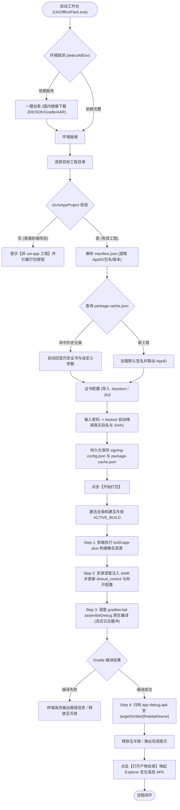

# uni-app 离线打包工作台 (UniApp Pack Desktop)

<p align="center">
  
</p>

<p align="center">
  <strong>基于 Electron + Vue 3 的轻量级 uni-app 本地离线打包与宿主调度工作台</strong>
</p>

<p align="center">
  
  
  
  
  
</p>

---

## 📖 简介与痛点

在传统的 uni-app 移动端跨端开发与交付过程中，开发者往往面临以下痛点：
1. **DCloud 官方云端打包**：每日有免费次数限制，高峰期排队耗时长（常需等待 10~30 分钟），且受公网传输和网络超时制约；
2. **Android Studio 原生打包**：IDE 庞大笨重（动辄占用数 GB 内存），对前端开发者学习成本高，本地 JDK/Gradle/Android SDK 版本冲突频发；
3. **原生配置繁琐易错**：DCloud 离线 AppKey 与 AppID、包名、证书真实 SHA1 的绑定规则严苛，稍有不慎即导致运行时报错闪退。

**UniApp Pack Desktop** 旨在提供一种**零 Android Studio 依赖**、**全自动环境自愈**、**极简可视化**的本地无头编译方案。通过四步流水线自动打通「前端构建 $\rightarrow$ 资源注入 $\rightarrow$ Gradle 编译 $\rightarrow$ APK 交付」全流程，实现随时随地本地极速出包。

---

## ✨ 核心特性

- 🚀 **零 Android Studio 依赖**：无需安装或打开 AS，后台无头直接调度 Gradle 守护进程完成编译。
- 🛠️ **双构建模式（正式包 / 自定义基座）**：
  - **正式包（Release）**：全自动化编译、签名并归档至 `dist/*.apk`；
  - **自定义基座（Custom Base）**：一键生成调试基座并精准输出至 `unpackage/debug/android_debug.apk`，无缝对接 HBuilderX 真机运行调试。
- 🛠️ **底层环境智能诊断与国内镜像自愈**：
  - 自动嗅探 JDK 17、Android SDK、Gradle 8.0 及 DCloud 基座 AAR 26 个核心依赖包；
  - 提供华为云 JDK、Adoptium、腾讯云 Gradle 镜像以及定制 Android SDK MVP 套件的一键下载与静默配置。
- 🔍 **工程智能校验与误触拦截**：
  - 穿透检测 `manifest.json` 与 `pages.json`，支持 CLI 与 HBuilderX 工程结构；
  - 遇到非 uni-app 目录自动提示警告 Tag 并隐藏打包按钮，避免误操作。
- 🔑 **证书自动嗅探与别名/SHA1 提取**：
  - 导入 `.keystore` 或 `.jks` 证书并输入密码后，系统自动调用 `keytool` 提取内部真实 Entry 别名与标准 SHA1 指纹；
  - 别名默认联动 uni-app AppID，内置测试证书一键还原。
- 💾 **包名历史记忆库 (`package-cache.json`)**：
  - 以 Android 包名为 Key 自动缓存各项目的签名配置与自定义 APK 命名，切换项目时秒级自动回显。
- 🎨 **现代化前端架构设计**：
  - **UnoCSS + SCSS + CSS Variables** 样式分层体系，极致精简且易于维护；
  - **Views 目录架构**：`App.vue` 仅作为纯净根组件，视图页面解耦至 `src/views/` 目录；
  - **交互体验**：构建结果智能底部悬浮滑出，支持一键定位产物目录与主动关闭。
- 📦 **纯净构建与零污染**：
  - 打包过程中仅读取配置并输出最终产物至对应目录，不在用户源码工程中生成多余配置污点。
- 💻 **免安装绿色便携**：打包产物为单文件便携可执行程序 `UniOfflinePack.exe`，解压即用。

---

## 🔄 全链路业务流程图 (Architecture & Business Flow)



> 详细的 15 步全链路流转分析请参阅文档：[`docs/business-flow/uniapp-pack-desktop-flow.md`](docs/business-flow/uniapp-pack-desktop-flow.md)

---

## 🚀 快速上手 (Quick Start)

### 方式一：直接运行便携版（推荐）

1. 从 [Releases 页面](../../releases) 下载最新的绿色便携版 `UniOfflinePack.exe`；
2. 双击打开，在环境看板确认 JDK / SDK 等底层工具链已就绪；
3. 选择你的 uni-app 工程目录，点击「开始打包」即可。

### 方式二：本地源码运行与二次开发

#### 1. 前置依赖
- [Node.js](https://nodejs.org/) (>= 18.0.0)
- [pnpm](https://pnpm.io/) (>= 8.0.0)
- JDK 17 (推荐 Adoptium 或 华为云 JDK 17)

#### 2. 安装与启动
```powershell
# 1. 克隆代码仓库
git clone https://github.com/your-username/uniapp-pack-desktop.git
cd uniapp-pack-desktop

# 2. 安装项目依赖
pnpm i

# 3. 启动 Vite 前端渲染服务 (端口: 1420)
pnpm dev

# 4. 新开终端，启动 Electron 桌面宿主
pnpm electron:dev
```

#### 3. 编译打包生成 Windows 便携可执行文件 (.exe)
```powershell
pnpm pack:exe
```
执行完成后，将在 `release/` 目录下生成 `UniOfflinePack.exe` 单文件便携版程序。

---

## ⚠️ 离线打包核心避坑指南

### 1. DCloud 离线 AppKey 三要素强一致规则
DCloud 原生安全校验机制要求以下三者必须 **100% 保持一致**：
1. **uni-app AppID**（`manifest.json` 中的 `appid`，如 `__UNI__XXXXXX`）；
2. **Android 包名**（`manifest.json` 中的 `app-plus.distribute.android.packagename`）；
3. **签名证书真实 SHA1 指纹**（通过工作台自动嗅探或 `keytool -list -v` 提取）。

> 💡 **提示**：在工作台导入证书后，只需在证书密码框输入密码并按回车/失焦，系统会自动提取真实的 SHA1，复制该 SHA1 前往 [DCloud 开发者中心](https://dev.dcloud.net.cn/) 申请对应的离线 AppKey 即可。

### 2. JDK 推荐版本
本项目推荐使用 **JDK 17**。请避免使用 JDK 21+（可能会导致 Gradle 8.0 报 `Unsupported class file major version 65` 兼容性错误）。

---

## 📂 目录结构说明

```text
uniapp-pack-desktop/
├── electron/                 # Electron 主进程模块
│   ├── main.js               # 主进程入口：生命周期、IPC 通道、构建调度
│   ├── preload.js            # 预加载脚本：暴露安全的 contextBridge
│   └── utils/                # 环境探测器、清单解析器与下载引擎
├── shell/                    # Android 原生离线打包宿主工程
│   ├── app/                  # Android 原生 app 模块 (含 26 个 DCloud 基座 AAR)
│   ├── gradlew.bat           # Windows Gradle Wrapper 启动脚本
│   └── build.gradle          # Gradle 顶层构建脚本
├── src/                      # Vue 3 前端渲染进程
│   ├── api/                  # 前端 IPC 通信契约封装
│   ├── components/           # 页面复用组件 (配置表单、终端日志、环境看板、避坑指南)
│   ├── views/                # 业务视图页面 (HomeView, WorkbenchView, EnvView, GuideView, SettingsView)
│   ├── config/               # 签名配置 (signing-config) 与包名缓存 (package-cache)
│   ├── styles/               # SCSS 全局样式与 Token 变量体系
│   ├── App.vue               # 渲染进程纯净根组件
│   └── main.js               # 前端应用入口 (注册 UnoCSS)
├── docs/                     # 业务全链路流转文档
│   └── business-flow/        # 15步全链路标准化设计文档
├── index.html                # 桌面端 HTML 入口 (内联秒开骨架屏)
├── package.json              # 项目描述与依赖清单
├── uno.config.mjs            # UnoCSS 原子类与设计 Token 配置
└── vite.config.mjs           # Vite 构建配置 (ESM 模式，监听 1420 端口)
```

---

## 🛠️ 常见问题 (FAQ)

<details>
<summary><strong>Q: 运行 <code>pnpm electron:dev</code> 提示 <code>Electron failed to install correctly</code>？</strong></summary>

在 pnpm 10+ 下默认会忽略依赖的 postinstall 脚本，可执行以下命令重新触发安装：
```powershell
pnpm rebuild electron
```
如遇网络下载缓慢或超时，可配置国内镜像后重试：
```powershell
$env:ELECTRON_MIRROR="https://npmmirror.com/mirrors/electron/"
pnpm rebuild electron
```
</details>

<details>
<summary><strong>Q: 界面提示【非 uni-app 工程】且打包按钮被隐藏？</strong></summary>

工作台会严格校验所选目录下是否存在 `manifest.json` 或 `pages.json`。若为 CLI 工程，请确保选择了包含 `src/` 或根目录的有效工程根路径。
</details>

<details>
<summary><strong>Q: Gradle 编译报错 <code>SDK location not found</code>？</strong></summary>

说明宿主机未检测到 Android SDK。您可以在工作台的环境诊断看板中点击「一键安装 SDK」，系统将自动拉取定制的 Android SDK MVP 套件并同步至 `local.properties`。
</details>

---

## 🤝 贡献与反馈

欢迎提交 Issue 或 Pull Request 来完善本项目！
- 若遇到打包错误或有新功能诉求，请附带复现步骤与日志信息提交 [Issue](../../issues)；
- 欢迎贡献更多国内镜像源与跨平台支持。

---

## 📄 开源协议

本项目采用 [MIT License](LICENSE) 开源协议。
