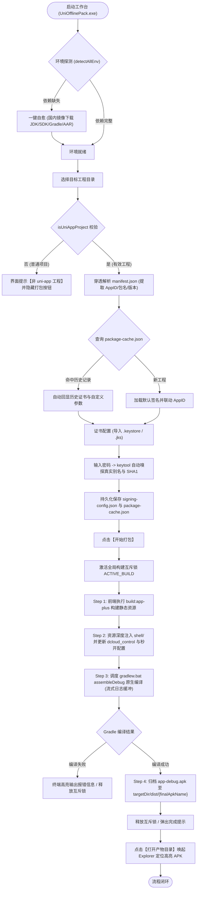

# uni-app 离线打包工作台 (UniApp Pack Desktop) 全链路流程梳理

- **分析粒度**：整项目级
- **入口定位**：`electron/main.js` (主进程调度) + `src/App.vue` (桌面端渲染中枢)

---

### 1. 业务背景
- **痛点与目的**：
  - DCloud 官方云端打包每日有次数限制，高峰期排队严重且受网络制约；
  - 传统 Android Studio 客户端庞大笨重、资源占用高、环境配置门槛高（Gradle、SDK、JDK 容易版本冲突）；
  - 跨端前端开发者难以直观排查原生离线打包报错，且签名证书、SHA1、包名与 DCloud AppKey 的三要素极易配置错漏。
- **业务价值**：
  - 实现“零 Android Studio 依赖”的本地极速一键离线打包；
  - 提供底层原生工具链国内镜像一键自愈能力；
  - 自动化完成证书嗅探、参数注入、Gradle 原生编译与产物归档，极大降低 uni-app 原生打包交付门槛。

---

### 2. 业务角色
- **主发起方**：前端/全栈移动端开发者（通过桌面端界面触发环境自愈、配置参数及发起打包）。
- **协作/受众方**：
  - Electron 宿主主进程（负责跨进程 IPC 调度、文件系统操作与子进程管理）；
  - 目标 uni-app 工程（提供前端源码与 `manifest.json` 配置）；
  - Android 原生壳工程 (`shell/`)（接收资源注入并运行 Gradle 编译）；
  - 本地 Gradle 守护进程（执行 `assembleDebug` 原生构建）；
  - 国内镜像源（华为云 JDK 镜像、腾讯云 Gradle 镜像、DCloud 官方 CDN）。

---

### 3. 业务对象
- **核心实体**：
  - 目标 uni-app 工程 (`target-project`)：包含 `manifest.json`、`pages.json` 及前端代码；
  - 签名证书 (`Keystore / JKS`)：包含证书文件、别名 (`alias`)、密码与 `SHA1` 指纹；
  - 原生壳工程 (`shell`)：包含 Gradle 构建脚本、Android 原生资产与 DCloud 基座 AAR；
  - 打包任务 (`BuildTask`)：包含互斥锁状态、构建日志流与最终 APK 产物。

---

### 4. 业务入口
- **系统总入口**：`electron/main.js`（窗口初始化、骨架屏启动、环境嗅探）；
- **前端交互入口**：`src/App.vue`（Tab 切换、全局状态响应、配置持久化与构建触发）。

---

### 5. 页面/功能
- **工作台面板 (`PackConfigCard.vue`)**：工程路径选择（带非 uni-app 标签拦截）、应用图标预览与修改、签名表单与包名参数回显。
- **环境看板 (`EnvStatusCard.vue`)**：JDK 17、Android SDK、Gradle 8.0、DCloud 26 个基座 AAR 依赖状态诊断与一键修复通道。
- **终端面板 (`LogTerminal.vue`)**：流式编译日志缓冲高亮展示、构建状态指示、产物定位快捷按钮。
- **避坑指南 (`PackGuideCard.vue`)**：JDK 17 配置说明、DCloud 离线 AppKey 申请三要素绑定规范与常见报错解决指南。

---

### 6. 用户操作
1. **环境诊断与自愈**：启动工作台，查看环境看板；对缺失项点击「一键安装/修复」。
2. **选择目标工程**：点击「选择目录」或输入路径，系统自动识别 uni-app 工程并提取包名与应用信息。
3. **配置签名凭据**：导入自定义证书并输入密码，系统自动提取内部真实别名与 SHA1 指纹。
4. **发起离线打包**：点击「开始打包」按钮，进入自动化构建流程。
5. **获取打包产物**：构建完成后，点击「打开产物目录」直接在系统资源管理器中定位高亮 APK。

---

### 7. 接口/API契约 (IPC Layer)
- `get_env_status`: `() => Promise<EnvStatus>`，返回 JDK/SDK/Gradle/AAR 就绪状态。
- `download_aar_libs` / `download_android_sdk` / `download_gradle_wrapper`: 国内源静默下载与自愈。
- `get_project_config`: `(projectDir: string) => Promise<ProjectConfig>`，穿透解析工程元数据。
- `verify_cert`: `(payload: CertVerifyPayload) => Promise<VerifyResult>`，调用 `keytool` 校验并提取别名与 SHA1。
- `start_offline_build`: `(params: BuildParams) => EventStream`，启动四步流水线并流式推送日志与完成事件。
- `open_directory`: `(dirPath: string) => Promise<void>`，调用原生资源管理器定位文件夹。

---

### 8. 业务动作
1. **工程校验**：穿透检测 `manifest.json` / `pages.json`，验证是否具备 uni-app 标识；
2. **配置同步**：更新 `src/config/signing-config.json` 与 `src/config/package-cache.json`；
3. **流水线调度**：
   - **Step 1 前端构建**：调度目标工程执行 `pnpm/yarn/npm run build:app-plus`；
   - **Step 2 资源注入**：将编译资源同步至 `shell/app/src/main/assets/apps/{appid}/www`，改写 `dcloud_control.xml`、`strings.xml` 及秒开启动配置；
   - **Step 3 原生编译**：注入环境变量并调度 `gradlew.bat assembleDebug`；
   - **Step 4 产物归档**：提取 `app-debug.apk`，重命名并归档至用户工程 `dist/` 目录。

---

### 9. 数据变化
- **本地配置文件持久化**：
  - `src/config/signing-config.json`：写入当前生效的证书路径、密码、别名与 SHA1；
  - `src/config/package-cache.json`：以 Android 包名为 Key，保存历史签名凭据与自定义包名映射；
  - `shell/local.properties`：自动同步对齐当前宿主机的 `sdk.dir`。
- **文件生成与流转**：
  - 目标工程生成：`dist/build/app-plus` 前端静态资源包；
  - 原生壳工程更新：`assets/apps/{appid}/www`、`AndroidManifest.xml`、`build.gradle` 签名闭包；
  - 最终产物落地：`${targetDir}/dist/${appName}_v${version}.apk`。

---

### 10. 状态变化
- **构建任务状态机**：
  $$\text{IDLE (空闲待命)} \xrightarrow{\text{点击打包}} \text{BUILDING (构建中，激活互斥锁)} \xrightarrow{\text{编译完成}} \begin{cases} \text{SUCCESS (成功归档，高亮按钮)} \\ \text{FAILED (异常终止，保留报错日志)} \end{cases}$$
- **工程识别状态**：
  `UNCHECKED` $\rightarrow$ `VALID_UNIAPP (正常显示配置与打包按钮)` 或 `INVALID_PROJECT (展示警告Tag并禁用打包)`。

---

### 11. 业务规则
1. **DCloud 三要素强一致规则**：AppKey 必须与 `AppID`、`Android包名` 及 `证书SHA1` 严格匹配，否则打包后 App 启动将报错并闪退；
2. **构建互斥规则**：同一时间仅允许一个离线打包任务运行（全局 `ACTIVE_BUILD` 互斥锁，带 1 小时看门狗超时防护）；
3. **工程安全拦截规则**：若选定目录不包含有效的 uni-app 配置文件，强制禁用打包按钮，杜绝误操作；
4. **纯净无污染规则**：在用户工程内仅读取配置和写入最终 `dist/*.apk`，严禁在用户工程中残留任何临时中间文件或脚本。

---

### 12. 下一业务节点
- 打包成功：触发系统通知，激活「打开产物目录」按钮；
- 交付环节：开发者将 APK 安装至真机进行离线调试，或归档至发行交付通道。

---

### 13. 异常/分支
- **分支 1（非 uni-app 目录）**：界面提示 `非 uni-app 工程` Tag，清空应用参数，隐藏打包按钮；
- **分支 2（证书密码错误）**：`keytool` 校验失败，界面提示密码错误，不覆盖原有别名与 SHA1；
- **分支 3（缺少 Android SDK）**：Gradle 构建前拦截，提示 SDK 路径缺失，引导点击一键安装；
- **分支 4（编译失败）**：捕获 Gradle 退出码，高亮定位错误日志并弹窗提示，释放互斥锁。

---

### 14. 业务结果
- 开发者获得可在 Android 物理设备或模拟器直接安装运行的独立 APK 离线安装包；
- 实时日志终端完整记录前端构建和 Gradle 编译输出，便于溯源排查。

---

### 15. 后续影响
- 对应 Android 包名的签名配置被自动记忆入库，下次打开同包名项目时秒级恢复；
- 成功构建的 APK 产物更新至工程根目录下的 `dist/`，可直接交付测试或分发。

---

### 16. 全链路可视化流程图 (Mermaid)

