# uni-app 通用离线打包工作台 (uniapp-pack-workbench) 业务全链路流转文档

## 1. 方案概述与系统定位

`uniapp-pack-workbench` 是针对 uni-app 跨端工程的轻量化本地离线打包与宿主调度工作台。该系统旨在摆脱对 Android Studio 繁重界面及 DCloud 官方云端打包队列的依赖，打通从「前端代码构建 -> 原生资源注入 -> Gradle 原生编译 -> 自动化归档交付」的本地全闭环流水线。

### 1.1 核心价值
- **零 AS 依赖**：无需启动 Android Studio，基于本地无头环境调度 Gradle。
- **环境自愈与国内极速链路**：智能探测宿主机的 JDK、Android SDK、Gradle 以及 DCloud AAR 依赖，支持国内镜像一键自愈补齐与极速配置。
- **结构自兼容**：无缝兼容 Vue3/Vite CLI、Vue2/Webpack CLI、HBuilderX 标准工程以及 Monorepo 多包结构。
- **证书双模敏捷生成**：支持导入 DCloud 云端生成证书（自动嗅探别名与指纹），亦支持调用本地 `keytool` 1秒快速生成 100 年有效期的商用 Release 证书。
- **三位一体运行形态**：支持独立桌面应用客户端（Electron + Vue3 便携版 `UniAppPackDesktop.exe`）、Web GUI 控制台（`:3344`）与 CLI 命令行无人值守构建（`pack-apk.js`）。

---

## 2. 架构拓扑与核心组件

```
+---------------------------------------------------------------------------------------------------+
|                                     表现层 (Presentation Layer)                                    |
|   +-------------------------------------------------------------------------------------------+   |
|   |                  Electron 桌面端 (Vue 3 + Vite + SCSS + Pinia) / Web 控制台                |   |
|   |  - EnvStatusCard: JDK/SDK/Gradle/AAR 环境看板 (含华为云/官方镜像一键直通与自愈通道)         |   |
|   |  - PackConfigCard: 上下流式工作台 (工程基础配置 + 签名证书双模配置/生成模态框 + 发行参数)   |   |
|   |  - CreateCertModal: 商用 2048 位 RSA 证书一键可视化生成 (100年有效、强密码发生器)          |   |
|   |  - LogTerminal: 流水线日志通栏终端 (80ms 高性能缓冲渲染 + 产物一键下载/定位)              |   |
|   |  - PackGuideCard: 避坑与配置指南 (JDK 17 配置、DCloud AppKey、常见故障速查)                |   |
|   +-------------------------------------------------------------------------------------------+   |
+-------------------------------------------------+-------------------------------------------------+
                                                  | IPC (contextBridge) / HTTP & SSE
+-------------------------------------------------v-------------------------------------------------+
|                                     桌面宿主与调度服务层 (Electron & Server)                       |
|   +-------------------------------------+   +-----------------------+   +---------------------+   |
|   |    Electron Main (workbench.js)     |   | server.js (HTTP+SSE)  |   | pack-apk.js (CLI)   |   |
|   | - 启动秒开 (ready-to-show + 骨架屏)  |   | - 并发构建互斥锁      |   | - 命令行参数解析    |   |
|   | - 1420 端口 Vite HMR 动态探测       |   | - 原生文件选择与代理  |   | - 无人值守批处理    |   |
|   | - open_url (默认浏览器外部隔离)     |   | - SSE 实时编译流推送  |   | - CI/CD 流水线集成  |   |
|   | - generate_cert_file (keytool 调用) |   |                       |   |                     |   |
|   | - 国内高速自愈下载引擎              |   |                       |   |                     |   |
|   +-------------------------------------+   +-----------------------+   +---------------------+   |
+-------------------------------------------------+-------------------------------------------------+
                                                  |
+-------------------------------------------------v-------------------------------------------------+
|                                     核心逻辑与工具层 (Core Engine)                                  |
|   +----------------------------------+   +----------------------------------+   +-------------+   |
|   |      utils/env-detector.js       |   |     utils/manifest-parser.js     |   | 容灾与快照  |   |
|   | - JDK/SDK/Gradle/AAR 跨盘符探测  |   | - 括号栈配对算法 findObjectRange |   | - backups/  |   |
|   | - local.properties 跨设备同步    |   | - manifest 注释与控制字符清洗    |   |   改前快照  |   |
|   | - keytool 缓存与 15s 看门狗超时  |   | - 正则保底容错字段抽取           |   |   每日隔离  |   |
|   +----------------------------------+   +----------------------------------+   +-------------+   |
+-------------------------------------------------+-------------------------------------------------+
                                                  |
+-------------------------------------------------v-------------------------------------------------+
|                                     物理存储与原生宿主层 (Storage & Shell)                         |
|  [用户工程] target-project/ (src/manifest.json, dist/build/app-plus, dist/*.apk)                  |
|  [配置中心] config/ (pack-config.json, release.keystore)                                          |
|  [原生宿主] uniapp-minimal-shell/ (app/src/main/assets, build.gradle, gradlew.bat)                |
|  [离线 SDK] uniapp-minimal-shell/app/libs/ (DCloud 官方基座 26 个核心 AAR 依赖包)                  |
+---------------------------------------------------------------------------------------------------+
```

### 2.1 关键模块职责映射
| 文件 / 目录 | 核心职责 |
| :--- | :--- |
| `desktop/` | Electron + Vue 3 桌面端工程：包含渲染进程组件、Pinia 状态、SCSS 样式与编译打包配置。 |
| `desktop/electron/main.js` | 桌面端主入口：管控主窗口生命周期、`ready-to-show` 首屏秒开、开发环境 1420 端口探测。 |
| `desktop/electron/workbench.js` | 桌面端调度核心：封装 `generate_cert_file`、`open_url`、`download_*` 等原生 IPC 处理器。 |
| `desktop/src/components/PackConfigCard.vue` | 双卡片工作台：整合工程基础配置、签名证书双模切换、别名/密码自动回填与发行打包触发。 |
| `desktop/src/components/CreateCertModal.vue` | 证书创建模态框：配置别名、发行组织信息、自动生成高强度密码并调用 `keytool` 签发。 |
| `desktop/src/components/EnvStatusCard.vue` | 环境诊断看板：提供 JDK、SDK、Gradle、AAR 状态感知，集成华为云镜像下载与配置指南直达。 |
| `desktop/src/components/LogTerminal.vue` | 通栏日志终端：基于流式日志缓冲区渲染编译过程，展示打包成功横幅与产物定位按钮。 |
| `server.js` | Web 后端服务：提供 HTTP/SSE API，支持 Web 模式下的环境检测、配置同步与实时编译流。 |
| `client.html` | 轻量 Web 控制台单页：纯原生 JS/CSS 实现，为无 Node-Electron 环境提供备选可视化界面。 |
| `pack-apk.js` | 独立 CLI 构建入口：供 CI/CD 自动化流水线直接调用，全流程无 GUI 依赖。 |
| `utils/env-detector.js` | 底层环境嗅探引擎：支持盘符穿透、环境变量与系统注册路径嗅探，负责 `local.properties` 自愈同步。 |
| `utils/manifest-parser.js` | 工程解析引擎：基于花括号栈算法实现 `manifest.json` 容错解析与安全修改。 |
| `scripts/setup-mvp-sdk.js` | 自动化 SDK 部署器：极速下载并组装 `platforms;android-33`、`build-tools` 与官方 Licenses。 |
| `config/` | 凭据与配置持久化中心：集中保存 `pack-config.json` 与各项目专用签名证书。 |
| `backups/` | 容灾隔离目录：统一存放以平铺路径命名的改前快照，杜绝源码污染。 |

---

## 3. 业务全链路时序全景

```mermaid
sequenceDiagram
    autonumber
    actor User as 开发者
    participant UI as 桌面端 / Web (Vue3 / client.html)
    participant Core as Electron 调度核 (workbench.js / server.js)
    participant Engine as 环境与解析引擎 (utils)
    participant UserApp as 目标 uni-app 工程
    participant Shell as 原生壳工程 (uniapp-minimal-shell)
    participant Gradle as 本地 Gradle 守护进程

    Note over User,Core: 阶段一：桌面端秒开与环境自愈检测
    User->>Core: 启动桌面端 (UniAppPackDesktop.exe / npm run electron:dev)
    Core->>Core: 探测 1420 端口 (250ms)：优先加载 Vite HMR，离线回退本地 dist
    Core->>UI: 监听 ready-to-show 事件，结合内联 CSS 骨架屏秒开渲染
    UI->>Core: 触发环境就绪检测 (get_env_status / GET /api/env)
    Core->>Engine: detectAllEnv() [探测 JDK、SDK、Gradle、AAR]
    alt 依赖缺损自愈
        User->>UI: 点击一键修复缺损环境
        UI->>Core: 触发修复指令 (AAR / SDK / Gradle)
        Core->>Core: 国内镜像加速下载 (DCloud CDN / 腾讯云镜像)
        Core-->>UI: 实时返回下载解压进度并完成就绪
    else JDK 缺失
        User->>UI: 点击【🌐 下载 JDK】/【📖 配置文档】
        UI->>Core: IPC open_url (直达 Adoptium 官网或华为云镜像)
        Core->>User: 唤起系统默认浏览器打开下载源
    end
    Engine-->>UI: 返回全绿就绪看板与证书 SHA1 缓存

    Note over User,UserApp: 阶段二：工程智能识别与配置载入
    User->>UI: 点击选择或输入 uni-app 项目目录
    UI->>Core: IPC select_dir / 原生文件选择器
    Core->>Engine: findManifestPath() + parseManifestJson()
    Engine->>UserApp: 穿透探测 manifest.json (容错清理注释与控制符)
    Core->>UserApp: 读取 scripts/.packrc.json (获取自定义 apkName)
    Core-->>UI: 回填 AppName, AppID, PackageName, Version, AppKey
    UI->>Core: 加载桌面应用图标并本地预览

    Note over User,Shell: 阶段三：证书双模配置与三要素强绑定
    alt 方式 A：导入已有 / DCloud 证书
        User->>UI: 点击【📁 选择证书】(选择 .keystore / .jks)
        UI->>Core: IPC import_cert_file + 输入密码
        Core->>Engine: extractSha1() 自动嗅探 KeyAlias 并提取 SHA1 指纹
        Core-->>UI: 表单自动回填别名、密码与最新 SHA1
    else 方式 B：本地 1 秒生成商用证书 (⚡ 生成证书)
        User->>UI: 点击【⚡ 生成证书】呼出 CreateCertModal
        User->>UI: 填写别名、组织信息、点击一键生成强密码
        UI->>Core: IPC generate_cert_file
        Core->>Core: 调用本地 keytool -genkeypair (2048位 RSA, 100年有效)
        Core->>Core: 产出 keystore 写入 config/ 并动态提取 SHA1
        Core-->>UI: 自动写入工作台表单，弹出成功提示
    end
    UI->>Core: 保存配置并同步原生壳 (save_pack_config)
    Core->>Shell: updateGradleSigning() 动态改写 app/build.gradle
    Core->>Shell: 同步 strings.xml (app_name) 与 AndroidManifest.xml (dcloud_appkey)

    Note over User,Gradle: 阶段四：离线打包流水线四步闭环
    User->>UI: 点击【一键开始离线打包】
    UI->>Core: IPC start_pack / GET /api/build (建立流式传输)
    Core->>Core: 激活全局构建互斥锁 ACTIVE_BUILD (带 1h 看门狗超时)
    
    rect rgb(20, 30, 45)
        Note over Core,UserApp: Step 1: 前端代码离线构建
        Core->>UserApp: 执行 build:app-plus (pnpm / yarn / npm)
        UserApp-->>Core: 编译产物输出至 dist/build/app-plus
        Core-->>UI: 推送 Step 1 日志
    end

    rect rgb(20, 45, 30)
        Note over Core,Shell: Step 2: 资源深度注入与秒开优化
        Core->>UserApp: applyFastSplashScreen() (改写 manifest 禁用等待，备份原文件)
        Core->>Shell: 异步清空并全量拷贝资源至 assets/apps/{appid}/www
        Core->>Shell: 写入 dcloud_control.xml 绑定 appid
        Core->>Shell: 剔除拉伸 splash.png，同步桌面图标与 strings.xml
        Core-->>UI: 推送 Step 2 资源注入完成
    end

    rect rgb(45, 30, 20)
        Note over Core,Gradle: Step 3: Gradle 本地原生编译
        Core->>Engine: syncLocalProperties() 跨设备对齐 SDK 路径
        Core->>Gradle: spawn(gradlew.bat assembleDebug) 注入 JAVA_HOME/ANDROID_HOME
        Gradle-->>Core: 流式输出构建进度
        Core-->>UI: 80ms 时间片批量渲染编译日志
    end

    rect rgb(35, 25, 45)
        Note over Core,UserApp: Step 4: 产物归档与交付
        Gradle-->>Core: 编译成功产出 app-debug.apk
        Core->>UserApp: 拷贝归档至 dist/{finalApkName}
        Core-->>UI: 推送打包完成通知，展示产物卡片与大小
        Core->>Core: 释放构建互斥锁
    end

    UI->>UI: 弹出成功横幅，展示【📂 打开输出目录】与【📥 下载 APK】
    User->>UI: 点击打开目录 -> IPC open_output_dir -> 唤起 Windows Explorer 并高亮文件
```



---

## 4. 阶段全链路深度拆解

### 4.1 阶段一：服务引导与国内极速环境自愈

系统启动时执行环境全量探测（`detectAllEnv`），确保所有前置原生工具链闭环可用，并为缺失项提供国内极速自愈通道：

1. **JDK 17 探测与极速下载指引 (`detectJdk`)**
   - **多阶嗅探**：`JAVA_HOME` 环境变量 -> `where.exe javac/java` 软链接物理路径 -> 盘符深度穷举（HBuilderX 内置 JRE `plugins/amazon-corretto`、Adoptium、Android Studio jbr）。
   - **版本核验**：执行 `java -version` 提取主版本号，校验是否匹配推荐的 **JDK 17**。
   - **下载与配置通道**：
     - 若未安装 JDK，界面常驻显示「📖 配置文档」弹窗与「🌐 下载 JDK」快捷入口。
     - 通过 IPC `open_url` 调用系统默认浏览器直达：
       - **华为云高速镜像**：`https://mirrors.huaweicloud.com/openjdk/`（国内无须代理极速下载）；
       - **Adoptium 官方通道**：`https://adoptium.net/temurin/releases/?version=17`。
     - 配套提供 Windows 环境变量 `JAVA_HOME` 与 `Path` 的一键配置图文步骤。

2. **Android SDK MVP 极速部署器 (`detectAndroidSdk` / `setup-mvp-sdk.js`)**
   - **探测优先级**：`ANDROID_HOME` / `ANDROID_SDK_ROOT` -> 壳工程 `local.properties` -> 常见默认安装路径（`%LOCALAPPDATA%\Android\Sdk`、`D:\Android\Sdk`）。
   - **一键自愈能力**：若环境缺失，支持点击一键自动拉取定制的 **Android SDK MVP 套件**：
     - 自动组装 `platforms;android-33`（Android 13 编译平台）；
     - 自动部署 `build-tools;33.0.1`（包含 `aapt2`、`zipalign`、`apksigner`）；
     - 自动静默注入 Google 官方许可协议（`licenses/android-sdk-license`），避免编译时抛出 `License not accepted` 错误。

3. **DCloud 26 个核心基座 AAR 官方 CDN 极速下载引擎 (`download_aar_libs`)**
   - **离线依赖自愈**：针对离线打包必备的 26 个 DCloud 官方基础 AAR（如 `uniapp-v8-release.aar`、`base-release.aar`、`lib.5plus.base-release.aar`、`weex_videoplayer-release.aar` 等），内置高速并发下载机制。
   - **完整性校验**：下载后自动校验文件有效性与目标目录结构，自动部署至 `uniapp-minimal-shell/app/libs/`，免除开发者手动翻找 SDK 压缩包并逐个拷贝的繁琐操作。

4. **Gradle 8.0 Wrapper 腾讯云镜像修复 (`download_gradle_wrapper`)**
   - **网络痛点**：官方默认的 `services.gradle.org` 分发链接在国内频繁超时导致构建停滞。
   - **自愈方案**：自动将 `gradle-wrapper.properties` 的 `distributionUrl` 重定向为国内 **腾讯云镜像源**（`mirrors.cloud.tencent.com/gradle/gradle-8.0-bin.zip`），并支持一键检测和自动补齐缺失的 `gradle-wrapper.jar` 与批处理启动脚本。

5. **跨设备自愈保障 (`syncLocalProperties`)**
   - 解决更换电脑、目录迁移后 Gradle 报错 `SDK location not found` 的痛点。
   - 探测成功后，自动将标准化路径同步写入 `uniapp-minimal-shell/local.properties`：
     ```properties
     sdk.dir=D:/Android/Sdk
     ```

6. **安全调用防护与 SHA1 提取缓存 (`extractSha1`)**
   - **看门狗机制**：设置 `KEYTOOL_TIMEOUT = 15000`（15 秒硬超时），杜绝 JVM 进程因等待交互输入或证书损坏而发生死锁。
   - **多维防抖缓存**：基于 `文件路径 + 文件大小 + 修改时间 + 密码 Hash` 建立 30 秒有效期的内存缓存，避免频繁切页重复拉起 JVM。

---

### 4.2 阶段二：工程识别与配置容错解析

1. **工程结构智能穿透 (`findManifestPath`)**
   - **CLI 架构优先**：优先探测 `${projectDir}/src/manifest.json`。
   - **标准 HBuilderX 架构**：其次探测 `${projectDir}/manifest.json`。
   - **Monorepo / 多应用架构**：智能遍历 `apps/`、`packages/`、`client/` 等子目录寻找有效清单。

2. **Manifest 容错解析算法 (`utils/manifest-parser.js`)**
   - **注释与尾随逗号清理**：剔除 `/*...*/`、`//...` 以及 `,\s*([}\]])`。
   - **ASCII 控制字符清洗**：捕获未转义的 `\x00-\x1f`，转义为标准换行或直接清洗。
   - **正则保底抽取 (`extractManifestFieldsFallback`)**：在 JSON 语法损坏严重时，自动降级为精准正则表达式定向提取 `name`、`versionName`、`appid`、`packagename` 及 `icons`。

3. **安全对象替换定位算法 (`findObjectRange`)**
   - **花括号栈状态机**：按花括号深度 `depth` 计数，自动忽略字符串内部的括号与转义字符，精准定位嵌套对象物理起止区间，杜绝传统正则替换过早闭合破坏语法的缺陷。

---

### 4.3 阶段三：证书管理双模方案与 AppKey 鉴权绑定

DCloud 离线打包要求原生基座的三要素必须 **100% 强一致**，否则启动时将弹出报错拦截：
$$\text{DCloud 离线 AppKey} \Longleftrightarrow \begin{cases} 1.\ \text{uni-app AppID (manifest.json)} \\ 2.\ \text{Android 包名 (PackageName / ApplicationId)} \\ 3.\ \text{证书真实 SHA1 指纹 (keytool)} \end{cases}$$

系统在桌面端全面推行 **证书管理双模方案**，彻底解决开发者无证书、证书配置错、密码遗忘等痛点：

#### 方案 A：导入已有 / DCloud 云端证书（自动嗅探）
- 开发者从 DCloud 开发者中心或本地选择已有的 `.keystore` / `.jks` 证书文件。
- 工作台调用 `import_cert_file` 导入至 `config/`，并自动调用 `keytool -list -v` 嗅探内部的真实 `KeyAlias`（别名）并提取 `SHA1` 指纹。
- 自动填充到工作台表单，用户只需核验或输入一次密码即可完成配置。

#### 方案 B：本地 1 秒生成商用永久证书 (⚡ 一键生成)
- 适合新项目、测试发版或未在 DCloud 申请云端证书的场景。
- 开发者点击工作台【⚡ 生成证书】按钮，呼出 `CreateCertModal` 弹窗：
  - **证书文件名**：自定义或默认 `release.keystore`；
  - **证书别名**：自定义或默认 `release`；
  - **强密码生成器**：支持一键随机生成 16 位高强度安全密码，自动填充并支持一键复制，避免手工输入遗忘；
  - **发行信息**：预设 CN、OU、O、L、ST、C（中国）等标准 X.500 实体信息。
- **底层执行指令**：桌面端主进程调用本地 JDK 的 `keytool` 命令：
  ```bash
  keytool -genkeypair -alias release -keyalg RSA -keysize 2048 -validity 36500 -keystore config/release.keystore -storepass ****** -keypass ****** -dname "CN=UniApp Developer, OU=Mobile, O=App Studio, L=Beijing, ST=Beijing, C=CN"
  ```
- **核心特性**：
  - **2048 位 RSA 高强度加密**：满足各大应用商店上架安全审计要求；
  - **100 年超长有效期 (`validity 36500`)**：彻底避免证书过期导致应用无法升级覆盖；
  - **即生即用**：生成完毕后自动持久化至 `config/`，自动将路径、别名、密码写入配置，并立即提取出标准 SHA-1 指纹回显在工作台上，提供一键复制按钮直接前往 DCloud 开发者后台申请 AppKey。

#### 原生动态绑定与图标同步
- 每次证书确认后，自动改写壳工程 `uniapp-minimal-shell/app/build.gradle` 的 `signingConfigs.debug` 闭包，并同步证书文件。
- 同步桌面图标（覆盖 `mipmap-xxhdpi/ic_launcher.png` 与 `drawable/icon.png`）。
- 将应用名转义后写入 `app/src/main/res/values/strings.xml`，更新 `AndroidManifest.xml` 中的 `dcloud_appkey`。

---

### 4.4 阶段四：离线打包流水线四步执行模型

构建流水线通过流式通道（Electron IPC / SSE）全程受控于构建互斥锁：

#### 构建互斥保护 (`isBuildBusy`)
```javascript
let ACTIVE_BUILD = null;
const BUILD_MAX_MS = 60 * 60 * 1000; // 1小时看门狗，防止异常进程死锁
```
杜绝重复触发导致的 Gradle 进程冲突与缓存锁死。

#### 流水线四步闭环明细
- **Step 1/4: 前端离线构建**
  - 检测包管理工具：优先探测 `pnpm-lock.yaml` -> `pnpm.cmd build:app-plus`；其次 `yarn.lock` -> `yarn.cmd build:app-plus`；保底 `npm.cmd run build:app-plus`。
  - 自动定位构建产物目录：`dist/build/app-plus` > `dist/build/app` > `unpackage/dist/build/app-plus`。
- **Step 2/4: 资源深度注入与秒开模式启用**
  - 异步全量覆盖资源至：`uniapp-minimal-shell/app/src/main/assets/apps/${appid}/www`。
  - 重写 `app/src/main/assets/data/dcloud_control.xml` 绑定当前 AppID。
  - **秒开优化（杜绝白屏/变形拉伸）**：
    1. 清除拉伸的 `res/drawable/splash.png` 与 `res/drawable-xxhdpi/splash.png`。
    2. 向用户工程 `manifest.json` 注入原生秒开配置：
       ```json
       "splashscreen": {
           "alwaysShowBeforeRender": false,
           "waiting": false,
           "autoclose": true,
           "delay": 0
       }
       ```
- **Step 3/4: Gradle 本地原生编译**
  - 注入 `JAVA_HOME`、`ANDROID_HOME` 与 `ANDROID_SDK_ROOT` 环境变量。
  - 调度壳工程自带的 `gradlew.bat assembleDebug`。
  - 实时捕获输出流，经 80ms 高性能缓冲调度器送入渲染进程终端。
- **Step 4/4: 产物归档与分发交付**
  - 提取编译产物：`app/build/outputs/apk/debug/app-debug.apk`。
  - 命名决策：命令行参数 `--name` > `scripts/.packrc.json` 中的 `apkName` > 默认 `${appName}_v${version}.apk`。
  - 自动归档至用户项目的 `${targetDir}/dist/${finalApkName}`。
  - 界面弹出成功卡片，支持一键唤起 Windows Explorer 定位高亮 APK。

---

### 4.5 阶段五：桌面端极速启动与零黑屏渲染架构

为实现开箱即用的高品质桌面客户端体验，系统针对 Electron 窗口生命周期与开发/生产环境加载进行了专门优化：

1. **首屏零黑屏与秒开架构 (`ready-to-show` + 骨架屏)**
   - **痛点**：传统 Electron 应用直接 `show: true` 会出现 0.5~1.5 秒的白色或黑色闪烁空白窗口。
   - **解法**：创建窗口时设置 `show: false` 与原生暗黑底色 `backgroundColor: '#0f172a'`；在 HTML 入口内联纯 CSS 骨架屏；监听 `ready-to-show` 事件，确保 DOM 与静态样式完成首次布局后再触发 `win.show()`，达成丝滑无感秒开。

2. **开发模式 Vite HMR 动态智能探测 (250ms 端口嗅探)**
   - **痛点**：若在主进程中生硬固定加载 `http://localhost:1420`，在未启动 Vite 服务时会报错白屏；若写死直读本地 `dist`，在执行 `npm run electron:dev` 时 Vue 组件的热更新（HMR）无法生效。
   - **解法**：主进程启动时向 `http://127.0.0.1:1420` 发起并发轻量探测（设置 250ms 严格超时）：
     - 探测成功：动态接入 `http://127.0.0.1:1420`，开发者修改 Vue/SCSS 立即秒级热替换；
     - 探测超时 / 生产模式：平滑降级直读打包生成的 `desktop/dist/index.html`，保障独立运行时的高可用。

3. **外部链接安全隔离拉起 (`open_url`)**
   - 严禁在 Electron 主窗口内部跳转外部链接（避免破坏 SPA 单页应用状态与安全沙箱）。
   - 工作台内置 IPC `open_url`，统一调用 `electron.shell.openExternal(url)` 唤起用户系统默认浏览器访问外部文档、华为云镜像或 DCloud 官网。

---

## 5. 防御机制与工程可靠性规范

### 5.1 异步文件 I/O 规避 Windows Defender 卡顿
原生文件同步拷贝/递归删除（`fs.rmSync` / `fs.cpSync`）在 Windows 下易被 Windows Defender 实时扫描强行挂起，阻塞 Node.js 事件循环。
系统实现了异步版本 `copyDirInto`：
```javascript
async function copyDirInto(targetDir, sourceDir) {
  if (fs.existsSync(targetDir)) {
    if (fs.promises.rm) await fs.promises.rm(targetDir, { recursive: true, force: true });
    else fs.rmSync(targetDir, { recursive: true, force: true });
  }
  await fs.promises.mkdir(targetDir, { recursive: true });
  if (fs.promises.cp) await fs.promises.cp(sourceDir, targetDir, { recursive: true });
  else fs.cpSync(sourceDir, targetDir, { recursive: true });
}
```

### 5.2 写盘快照与容灾备份 (`backups/`)
为杜绝自动化注入破坏用户源码，所有对用户工程文件的覆写操作（如修改 `manifest.json` 或更新图标）必须前置触发 `backupFile`：
- 备份目录统一置于工作台自身的 `backups/<YYYY-MM-DD>/`，严禁写入用户工程内（避免 `.bak` 文件被打包进离线资源）。
- 文件名采用平铺路径哈希转换：`D_project_src_manifest.json.bak`。
- 同一文件在同一自然日内只记录首次（初始状态）的快照版本。

### 5.3 前端日志缓冲区与渲染降载
Gradle 编译时会瞬间产生上千行输出。若每收到一条 SSE 消息直接操作 DOM，会导致浏览器主线程回流卡死。
`client.html` 采用 **80ms 时间片防抖收集 + DocumentFragment 批量提交** 方案：
```javascript
let logBuf = [];
let logTimer = null;
function appendLog(text, type = 'normal') {
  logBuf.push({ text, type });
  if (logBuf.length >= 400) return flushLog();
  if (!logTimer) logTimer = setTimeout(flushLog, 80);
}
```

### 5.4 安全与路径穿越防御
- **CORS 收紧**：`resolveCorsOrigin` 仅回显同主机名、局域网对应主机或 `localhost` / `127.0.0.1`，防范网页恶意盗用。
- **APK 下载路径越权防护**：下载接口对入参进行严格的归一化检查：
  ```javascript
  const filePath = path.resolve(projectDir, `.${decodedPath}`);
  const inProject = filePath === projectDir || filePath.startsWith(projectDir + path.sep);
  ```
  阻断以 `/dist/../../` 方式窃取用户系统核心敏感文件的行为。
- **请求体截断限制**：`readBody` 设置 20MB 缓冲区上限，超过立即响应 HTTP 413 并切断连接。

### 5.5 IPC 进程通信安全与命令防注入
- **keytool 注入防护**：在主进程执行 `generate_cert_file` 时，针对证书别名、组织参数（CN、OU、O 等）进行严格过滤，禁止双引号、管道符 `|`、换行符等特殊控制字符注入，确保生成的命令参数严格闭合。
- **外部链接协议审查**：IPC `open_url` 强制只接受 `http:` / `https:` 安全网络协议，阻止以 `file:`、`javascript:`、`cmd:` 等潜在危险协议唤起本地系统程序。

### 5.6 视口流式布局与容器防撑破规范
- **上下流式自适应**：桌面端采用上下两段式布局：上方双卡片横向对齐（左侧工程基础 + 右侧证书与发行参数）；下方通栏全宽自适应日志终端。
- **Flex 子项防撑破**：在所有输入框、路径展示标签及终端代码容器均显式设置 `min-width: 0` 与 `overflow-wrap: break-word`，杜绝深层绝对路径或长包名撑破双卡片网格。

---

## 6. 配置文件与数据模型全景

### 6.1 桌面端 IPC 通信协议矩阵 (`desktop/electron/workbench.js`)

| IPC 通道名称 | 入参类型 | 返回数据类型 | 核心处理逻辑 |
| :--- | :--- | :--- | :--- |
| `get_env_status` | `void` | `Promise<EnvStatus>` | 嗅探 JDK、Android SDK、Gradle 及 AAR 26 个依赖项就绪状态。 |
| `get_pack_config` | `{ projectDir: string }` | `Promise<PackConfig>` | 提取应用清单、AppKey、证书 SHA1 及历史打包参数。 |
| `save_pack_config` | `PackConfigPayload` | `Promise<{ success: boolean }>` | 同步更新 `config/pack-config.json` 与原生壳工程配置。 |
| `select_dir` | `void` | `Promise<string \| null>` | 唤起系统原生目录选择对话框，自动识别 uni-app 项目根目录。 |
| `generate_cert_file` | `CertGenerateOptions` | `Promise<CertResult>` | 调度 `keytool -genkeypair` 生成 2048位 RSA 商用证书并提取 SHA1。 |
| `import_cert_file` | `void` | `Promise<ImportResult>` | 弹出文件选择器导入已有 `.keystore` / `.jks`，自动嗅探别名。 |
| `start_pack` | `BuildOptions` | `EventStream (log/done)` | 启动四步离线打包流水线，流式推送构建日志与错误栈。 |
| `cancel_pack` | `void` | `Promise<{ success: boolean }>` | 强行终止当前运行中的 Gradle 或前端 npm 子进程。 |
| `open_output_dir` | `{ projectDir: string }` | `Promise<void>` | 唤起 Windows Explorer 资源管理器并自动选中高亮产物 APK。 |
| `open_url` | `{ url: string }` | `Promise<void>` | 借助 `shell.openExternal` 调用系统默认浏览器打开外部网页。 |
| `download_aar_libs` | `void` | `Promise<{ success: boolean }>` | 从 DCloud 官方 CDN 下载并解压 26 个核心离线基座 AAR。 |
| `download_android_sdk` | `void` | `Promise<{ success: boolean }>` | 下载并静默部署 Android 33 与 Build-Tools 33.0.1 套件。 |
| `download_gradle_wrapper` | `void` | `Promise<{ success: boolean }>` | 切换为国内腾讯云 Gradle 镜像并补齐 Gradle Wrapper 文件。 |

### 6.2 凭据中心配置文件 (`config/pack-config.json`)
```json
{
  "signing": {
    "storeFile": "release.keystore",
    "storePassword": "******",
    "keyAlias": "release",
    "keyPassword": "******",
    "sha1": "35:12:F1:6E:9B:..."
  },
  "dcloud": {
    "appkey": "a1b2c3d4e5f6g7h8..."
  }
}
```

### 6.3 项目个性化构建配置 (`scripts/.packrc.json`)
存放于各 uni-app 项目根目录下，用于独立定义项目产物名：
```json
{
  "apkName": "积分商城-v1.0.0.apk"
}
```

### 6.4 历史状态存储 (`last-project.json`)
工作台用于记录最后一次构建的项目根路径，实现再次打开免选：
```json
{
  "lastProjectDir": "D:\\boil\\boil产品\\integral\\jie-ui"
}
```

---

## 7. 离线打包避坑与常见故障速查

| 现象 / 错误提示 | 根本原因分析 | 标准排查与处置路径 |
| :--- | :--- | :--- |
| `AppKey 与证书或包名不一致` | DCloud 开发者中心绑定的包名、证书 SHA1 或 AppID 与本地不符。 | 1. 在工作台复制提取的真实 SHA1；<br>2. 检查 `app/build.gradle` 的 `applicationId`；<br>3. 前往 DCloud 后台核对并重新生成 AppKey 填入工作台。 |
| `SDK location not found` | Android SDK 路径未配置或环境变量缺失。 | 在环境看板点击【一键安装 SDK】自愈，或配置系统环境变量 `ANDROID_HOME`。 |
| `Unsupported class file major version 65` | 使用了 JDK 21+ 编译旧版 Gradle 导致版本不兼容。 | 点击环境看板「📖 配置文档」，根据华为云/官方镜像安装并切换至 **JDK 17**。 |
| 桌面端开发环境热更新 (HMR) 失效 | Electron 启动时未探测到 Vite 1420 端口而回退至旧版本地 dist。 | 先在终端启动 `npm run dev`（监听 1420），再运行 `npm run electron:dev` 启动桌面窗口。 |
| 启动页图片变形拉伸 | DCloud 离线 SDK 默认对 `splash.png` 进行全屏拉伸。 | 工作台在 Step 2 阶段会自动执行 `cleanStretchedSplash` 并配置秒开直入模式，彻底移除变形图。 |
| 无法启动构建命令 `pnpm` / `yarn` | 宿主机未全局安装对应的包管理器。 | 配置系统环境变量 `PATH`，或在项目根目录使用 `npm` 进行依赖管理。 |
| Gradle 下载依赖持续超时/假死 | Gradle 官方分发链接或 Maven 境外源被国内网络限制。 | 在环境看板点击【修复 Gradle】，自动切换至腾讯云高速镜像源并注入国内 Maven 加速配置。 |
| 证书别名/密码遗忘导致无法打包 | 长期未维护旧项目导致遗忘密钥库口令。 | 点击【⚡ 生成证书】，1 秒生成 100 年永久商用 Release 证书，并用新 SHA1 重新申请 AppKey 即可。 |

