# uni-app 通用离线打包工作台 (uniapp-pack-workbench) 业务全链路流转文档

## 1. 方案概述与系统定位

`uniapp-pack-workbench` 是针对 uni-app 跨端工程的轻量化本地离线打包与宿主调度工作台。该系统旨在摆脱对 Android Studio 繁重界面及 DCloud 官方云端打包队列的依赖，打通从「前端代码构建 -> 原生资源注入 -> Gradle 原生编译 -> 自动化归档交付」的本地全闭环流水线。

### 1.1 核心价值
- **零 AS 依赖**：无需启动 Android Studio，基于本地无头环境调度 Gradle。
- **环境自愈与国内极速链路**：智能探测宿主机的 JDK、Android SDK、Gradle 以及 DCloud AAR 依赖，支持国内镜像一键自愈补齐与极速配置。
- **结构自兼容与工程智能校验**：无缝兼容 Vue3/Vite CLI、Vue2/Webpack CLI、HBuilderX 标准工程以及 Monorepo 多包结构；自动识别 uni-app 项目并具备非 uni-app 标记拦截保护。
- **证书智能导入与全自动解析**：支持自定义签名证书一键导入与密码自动嗅探，自动提取真实 Entry 别名、密码与 SHA1 指纹；别名默认联动 uni-app AppID，提供历史包名自动记忆回显。
- **轻量独立桌面运行形态**：提供独立桌面应用客户端（Electron + Vue3 便携版 `UniOfflinePack.exe`），无需安装、即开即用。

---

## 2. 架构拓扑与核心组件

```
+---------------------------------------------------------------------------------------------------+
|                                     表现层 (Presentation Layer)                                    |
|   +-------------------------------------------------------------------------------------------+   |
|   |                  Electron 桌面端 (Vue 3 + Vite + SCSS + JavaScript <script setup>)        |   |
|   |  - EnvStatusCard: JDK/SDK/Gradle/AAR 底层环境看板 (含华为云/腾讯云/官方镜像一键直达通道)  |   |
|   |  - PackConfigCard: 目标工程路径选择(带非uni-app Tag提示) + 签名证书配置 + 发行参数配置   |   |
|   |  - LogTerminal: 流水线日志通栏终端 (流式缓冲渲染 + 非uni-app隐藏打包按钮 + 产物定位)      |   |
|   |  - PackGuideCard: 避坑与配置指南 (JDK 17 配置、DCloud AppKey、常见故障速查)                |   |
|   +-------------------------------------------------------------------------------------------+   |
+-------------------------------------------------+-------------------------------------------------+
                                                  | IPC (contextBridge: electronBridge)
+-------------------------------------------------v-------------------------------------------------+
|                                     桌面宿主与调度服务层 (Electron Main)                           |
|   +-------------------------------------------------------------------------------------------+   |
|   |    electron/main.js                                                                       |   |
|   | - 启动秒开 (ready-to-show + 骨架屏)                                                       |   |
|   | - 1420 端口 Vite HMR 动态探测与生产 dist/ 离线回退                                        |   |
|   | - isUniAppProject 判定 (manifest.json / pages.json 穿透检测)                              |   |
|   | - 证书 SHA1 提取与缓存、密码自动嗅探与别名同步                                            |   |
|   | - 四步离线打包流水线执行 (前端构建 -> 资源注入 -> Gradle编译 -> 产物归档)                   |   |
|   | - 国内高速自愈下载引擎 (AAR 26包、Android SDK MVP、Gradle Wrapper)                        |   |
|   | - 目录/文件原生对话框代理与外部安全链接拉起                                               |   |
|   +-------------------------------------------------------------------------------------------+   |
+-------------------------------------------------+-------------------------------------------------+
                                                  |
+-------------------------------------------------v-------------------------------------------------+
|                                     配置与持久化存储层 (Storage & Cache)                          |
|  [用户工程] target-project/ (src/manifest.json, dist/build/app-plus, dist/*.apk)                  |
|  [证书中心] src/config/signing-config.json (当前生效的密钥库配置与内置默认 test.keystore)         |
|  [包名缓存] src/config/package-cache.json (按 Android 包名自动记忆历史签名配置与发包参数)         |
|  [原生宿主] shell/ (app/src/main/assets, app/build.gradle, gradlew.bat)                          |
|  [离线 SDK] shell/app/libs/ (DCloud 官方基座 26 个核心 AAR 依赖包)                                |
+---------------------------------------------------------------------------------------------------+
```

### 2.1 关键模块职责映射
| 文件 / 目录 | 核心职责 |
| :--- | :--- |
| `electron/main.js` | 桌面端主入口：掌控窗口生命周期、IPC 通道注册、工程校验、证书解析、打包调度与环境探测。 |
| `electron/preload.js` | 预加载脚本：通过 `contextBridge` 安全暴露 `electronBridge` (含 `invoke` 和 `listen`)。 |
| `src/App.vue` | 顶层根组件：状态管理中枢、Tab 导航切换、工程配置与签名联动响应式维护、Toast 提示管理。 |
| `src/components/PackConfigCard.vue` | 工程与配置卡片：工程目录选择、非 uni-app Tag 提示、应用图标展示与更换、签名表单自动回显。 |
| `src/components/EnvStatusCard.vue` | 环境诊断看板：提供 JDK、SDK、Gradle、AAR 四大底层核心依赖状态检测与一键修复通道。 |
| `src/components/LogTerminal.vue` | 通栏日志终端：基于流式日志缓冲区渲染编译进度、非 uni-app 工程时自动隐藏打包按钮、产物定位。 |
| `src/components/PackGuideCard.vue` | 离线打包指南：包含 JDK 17 环境配置、DCloud 离线 AppKey 申请三要素绑定规范与避坑指南。 |
| `src/api/workbench.js` | 前端 IPC 客户端接口：封装与 Electron 主进程通信的所有异步方法与事件监听器。 |
| `src/utils/fileDialog.js` | 原生系统对话框工具：调用主进程唤起文件夹选择器与证书文件选择器。 |
| `src/config/signing-config.json` | 统一签名凭据中心：保存当前全局/项目生效的证书文件、口令、别名与 SHA1 指纹。 |
| `src/config/package-cache.json` | 包名级记忆库：以 Android 包名为 Key 自动缓存对应的签名凭据与自定义 APK 产物名。 |
| `shell/` | 原生宿主壳工程：包含 Android 原生工程结构、build.gradle、清单文件与 DCloud 基座 AAR 依赖。 |

---

## 3. 业务全链路时序全景

```mermaid
sequenceDiagram
    autonumber
    actor User as 开发者
    participant UI as 桌面端 (Vue 3 渲染进程)
    participant Core as Electron 主进程 (electron/main.js)
    participant UserApp as 目标 uni-app 工程
    participant Shell as 原生壳工程 (shell/)
    participant Gradle as 本地 Gradle 守护进程

    Note over User,Core: 阶段一：桌面端秒开与底层环境就绪检测
    User->>Core: 启动桌面端 (UniOfflinePack.exe / npm run electron:dev)
    Core->>Core: 探测 1420 端口 (250ms)：开发环境加载 Vite HMR，离线生产加载 dist/
    Core->>UI: 监听 ready-to-show 事件，骨架屏秒开并展现窗口
    UI->>Core: IPC get_env_status
    Core->>Core: detectAllEnv() [嗅探 JDK 17, Android SDK, Gradle, AAR 26包]
    Core-->>UI: 返回底层工具链状态看板
    alt 底层依赖缺损自愈
        User->>UI: 点击一键修复缺损环境
        UI->>Core: 触发修复指令 (download_aar_libs / download_android_sdk / download_gradle_wrapper)
        Core->>Core: 国内镜像/官方 CDN 加速下载并自动解压配置
        Core-->>UI: 实时推送下载解压进度并完成就绪
    end

    Note over User,UserApp: 阶段二：工程智能识别与配置自动回显
    User->>UI: 选择或输入目标工程目录
    UI->>Core: IPC get_project_config (传入 projectDir)
    Core->>Core: isUniAppProject() 校验 (检查 manifest.json / pages.json)
    alt 非 uni-app 工程
        Core-->>UI: 返回 { is_uni_app: false, project_dir: dir }
        UI->>UI: 目标目录旁展示【非 uni-app 工程】Tag，清空应用参数，隐藏打包按钮
    else 验证通过 (有效 uni-app 工程)
        Core->>UserApp: 穿透解析 manifest.json 提取 AppName, Version, AppID, PackageName
        Core->>Core: 查询 package-cache.json 匹配历史包名配置
        Core-->>UI: 返回应用参数、证书配置、is_uni_app: true
        UI->>UI: 移除警告 Tag，展示打包按钮，加载桌面应用图标，自动回显配置
    end

    Note over User,Core: 阶段三：证书配置与全自动别名/SHA1 提取
    alt 导入自定义证书
        User->>UI: 点击【📁 选择证书】(选择 .keystore / .jks)
        UI->>Core: IPC import_cert_file + IPC verify_cert (输入密码失焦自动触发)
        Core->>Core: keytool 自动提取内部真实 Entry 别名与 SHA1 指纹
        Core-->>UI: 自动填充别名、同步别名密码与 SHA1 指纹
    else 恢复默认测试证书
        User->>UI: 点击【恢复默认调试证书】
        UI->>Core: 自动重置为内置 test.keystore 及对应调试指纹
    end
    UI->>Core: IPC save_project_config (同步写入 signing-config.json 与 package-cache.json)

    Note over User,Gradle: 阶段四：离线打包流水线四步闭环 (无多余生成文件)
    User->>UI: 点击【打包】按钮
    UI->>Core: IPC start_offline_build
    Core->>Core: 激活全局构建互斥锁 ACTIVE_BUILD
    
    rect rgb(20, 30, 45)
        Note over Core,UserApp: Step 1: 前端离线重新构建
        Core->>UserApp: 调度 pnpm / yarn / npm 执行 build:app-plus
        UserApp-->>Core: 输出编译产物至 dist/build/app-plus
        Core-->>UI: 流式推送 Step 1 日志
    end

    rect rgb(20, 45, 30)
        Note over Core,Shell: Step 2: 资源深度注入与原生配置同步
        Core->>UserApp: applyFastSplashScreen() (改写 manifest 启用秒开直入)
        Core->>Shell: 异步覆盖资源至 assets/apps/{appid}/www
        Core->>Shell: 同步 dcloud_control.xml (绑定 appid)
        Core->>Shell: 同步 strings.xml (应用名) 与 AndroidManifest.xml (包名/AppKey)
        Core->>Shell: updateGradleSigning() 同步 signingConfigs 闭包
        Core-->>UI: 推送 Step 2 资源注入完成日志
    end

    rect rgb(45, 30, 20)
        Note over Core,Gradle: Step 3: Gradle 本地原生编译
        Core->>Shell: syncLocalProperties() 跨设备对齐 SDK 路径
        Core->>Gradle: spawn(gradlew.bat assembleDebug) 注入 JAVA_HOME/ANDROID_HOME
        Gradle-->>Core: 实时流式输出编译日志
        Core-->>UI: 80ms 时间片批量缓冲渲染终端日志
    end

    rect rgb(35, 25, 45)
        Note over Core,UserApp: Step 4: 产物归档与交付
        Gradle-->>Core: 编译成功产出 app-debug.apk
        Core->>UserApp: 拷贝归档至 dist/{finalApkName}
        Core-->>UI: 推送打包完成通知，展示成功横幅与产物信息
        Core->>Core: 释放构建互斥锁
    end

    User->>UI: 点击【📂 打开产物目录】 -> IPC open_directory -> 唤起 Explorer 定位高亮 APK
```



---

## 4. 阶段全链路深度拆解

### 4.1 阶段一：服务引导与底层环境就绪检测

系统启动时执行环境全量探测（`detectAllEnv`），确保所有前置原生工具链闭环可用，并为缺失项提供国内极速自愈通道：

1. **JDK 17 探测与极速下载指引 (`detectJdk`)**
   - **多阶嗅探**：`JAVA_HOME` 环境变量 -> `where.exe javac/java` 物理路径 -> 盘符深度穷举（HBuilderX 内置 JRE `plugins/amazon-corretto`、Adoptium、Android Studio jbr）。
   - **版本核验**：执行 `java -version` 提取主版本号，校验是否匹配推荐的 **JDK 17**。
   - **下载通道**：通过 IPC `open_url` 调用系统默认浏览器直达华为云高速镜像或 Adoptium 官方通道。

2. **Android SDK MVP 极速部署器 (`detectAndroidSdk` / `download_android_sdk`)**
   - **探测优先级**：`ANDROID_HOME` / `ANDROID_SDK_ROOT` -> 壳工程 `local.properties` -> 常见安装路径（`%LOCALAPPDATA%\Android\Sdk`、`D:\Android\Sdk`）。
   - **一键自愈能力**：若环境缺失，支持点击一键自动拉取定制的 **Android SDK MVP 套件**（包含 `platforms;android-33`、`build-tools;33.0.1` 及 Google 官方许可协议授权）。

3. **DCloud 26 个核心基座 AAR 官方 CDN 下载引擎 (`download_aar_libs`)**
   - **离线依赖自愈**：针对离线打包必备的 26 个 DCloud 官方基础 AAR（如 `uniapp-v8-release.aar`、`base-release.aar` 等），内置高速并发下载机制，自动部署至 `shell/app/libs/`。

4. **Gradle 8.0 Wrapper 腾讯云镜像修复 (`download_gradle_wrapper`)**
   - **自愈方案**：自动将 `gradle-wrapper.properties` 的 `distributionUrl` 重定向为国内 **腾讯云镜像源**（`mirrors.cloud.tencent.com/gradle/gradle-8.0-bin.zip`），并支持一键检测和自动补齐缺失的 `gradle-wrapper.jar` 与启动脚本。

5. **跨设备自愈保障 (`syncLocalProperties`)**
   - 解决更换电脑、目录迁移后 Gradle 报错 `SDK location not found` 的痛点。探测成功后，自动将标准化路径同步写入 `shell/local.properties`。

---

### 4.2 阶段二：工程智能识别与配置容错解析

1. **工程有效性判定 (`isUniAppProject`)**
   - 检查目标根目录或 `src/` 目录下是否存在 `manifest.json` 或 `pages.json`。
   - 对 `manifest.json` 进行特征内容校验（确保包含 `appid`、`app-plus`、`mp-`、`quickapp`、`vueVersion` 等 uni-app 特征字段），防止误判普通前端项目。
   - 兼容检测 `apps/`、`packages/`、`client/` 等多包子目录结构。
   - **拦截保护**：若判定为非 uni-app 工程，界面以 Tag 标签明确提示 `非 uni-app 工程`，自动清空不相关的参数与图标，并直接隐藏打包按钮，从根源上杜绝非 uni-app 目录误触发打包。

2. **应用包名多级提取 (`findManifestPath` + 正则保底)**
   - 穿透探测 `manifest.json`：优先从 `app-plus.distribute.android.packagename` 及其变体（`packageName`、`package_name`、`package`）深度抽取。
   - 文本正则兜底抽取：若 JSON 解析失败或字段缺失，自动降级为全文本正则匹配。
   - 前端 UI 响应联动：成功提取到包名时，输入框自动设为只读并展示 `已提取 (只读)`；未提取到时允许开发者手动输入补充并展示 `未提取 (可编辑)`。

---

### 4.3 阶段三：证书智能导入与包名缓存自动回显

DCloud 离线打包要求原生基座的三要素必须 **100% 强一致**：
$$\text{DCloud 离线 AppKey} \Longleftrightarrow \begin{cases} 1.\ \text{uni-app AppID (manifest.json)} \\ 2.\ \text{Android 包名 (PackageName / ApplicationId)} \\ 3.\ \text{证书真实 SHA1 指纹 (keytool)} \end{cases}$$

1. **证书别名默认回填 AppID**
   - 在未导入自定义证书或初始化工程时，证书别名 `keyAlias` 默认自动填充为当前项目的 uni-app AppID（`__UNI__xxx`），降低开发者心智负担。

2. **输入密码全自动嗅探与别名/SHA1 提取 (`verify_cert`)**
   - 开发者导入 `.keystore` 或 `.jks` 证书文件后，在密码输入框输入或失焦时，系统自动调用 `keytool -list -v` 验证密钥库。
   - 校验成功后，优先使用证书内部真实的 Entry 别名覆盖当前别名，同步将别名密码更新为证书密码，并提取出标准 SHA1 指纹自动填入表单，完成全自动静默保存。

3. **按包名缓存与自动回显配置 (`package-cache.json`)**
   - 系统以 Android 包名为主键维护历史打包配置库。
   - 当开发者在多个工程之间切换时：
     - 若新工程包名与当前不一致，自动触发重置逻辑；
     - 若新包名在 `package-cache.json` 中存在历史记录，则自动秒级恢复对应的证书文件、别名、密码、SHA1 及自定义 APK 名称；
     - 若未匹配到历史记录，则提示检测到新项目并保持初始安全状态。

4. **原生动态绑定与图标同步**
   - 每次保存配置后，自动改写壳工程 `shell/app/build.gradle` 的 `signingConfigs.debug` 闭包，并同步证书文件。
   - 同步桌面图标至 Android 资源目录（覆盖 `mipmap-xxhdpi/ic_launcher.png` 与 `drawable/icon.png`）。
   - 将应用名转义写入 `shell/app/src/main/res/values/strings.xml`，更新 `AndroidManifest.xml` 中的 `dcloud_appkey`。

---

### 4.4 阶段四：离线打包流水线四步执行模型

构建流水线通过流式通道（Electron IPC）全程受控于构建互斥锁：

#### 构建互斥保护 (`isBuildBusy`)
```javascript
let ACTIVE_BUILD = null;
const BUILD_MAX_MS = 60 * 60 * 1000; // 1小时看门狗，防止异常进程死锁
```
杜绝重复触发导致的 Gradle 进程冲突与缓存锁死。

#### 流水线四步闭环明细
- **Step 1/4: 前端离线重新构建**
  - 移除了“跳过前端构建”选项，每次执行均强制重新构建，保证离线资源绝对最新。
  - 自动探测包管理工具：`pnpm-lock.yaml` -> `pnpm.cmd build:app-plus`；`yarn.lock` -> `yarn.cmd build:app-plus`；保底 `npm.cmd run build:app-plus`。
  - 定位构建产物目录：`dist/build/app-plus` > `dist/build/app` > `unpackage/dist/build/app-plus`。
- **Step 2/4: 资源深度注入与原生秒开启用**
  - 异步全量覆盖资源至：`shell/app/src/main/assets/apps/${appid}/www`。
  - 重写 `shell/app/src/main/assets/data/dcloud_control.xml` 绑定当前 AppID。
  - 清除拉伸的 `res/drawable/splash.png`，向 `manifest.json` 注入原生秒开配置（`alwaysShowBeforeRender: false`, `waiting: false`, `autoclose: true`, `delay: 0`），杜绝启动白屏。
  - **无污染原则**：目标工程中在打包时**不生成任何 `config/` 或 `scripts/` 目录**，原生配置与凭据纯在内部壳工程与内存中调度，保证用户代码仓库纯净。
- **Step 3/4: Gradle 本地原生编译**
  - 注入 `JAVA_HOME`、`ANDROID_HOME` 与 `ANDROID_SDK_ROOT` 环境变量。
  - 调度壳工程自带的 `gradlew.bat assembleDebug`。
  - 实时捕获输出流，经 80ms 高性能缓冲调度器批量送入渲染进程终端。
- **Step 4/4: 产物归档与交付**
  - 提取编译产物：`shell/app/build/outputs/apk/debug/app-debug.apk`。
  - 命名规则：`${appName}_v${version}.apk`。
  - 自动归档至用户项目的 `${targetDir}/dist/${finalApkName}`。
  - 界面展示打包成功横幅与产物信息，支持一键唤起 Windows 资源管理器定位高亮 APK。

---

### 4.5 阶段五：桌面端极速启动与零黑屏渲染架构

1. **首屏零黑屏与秒开架构 (`ready-to-show` + 骨架屏)**
   - 创建窗口时设置 `show: false` 与暗黑底色 `backgroundColor: '#0f172a'`；在 HTML 入口内联纯 CSS 骨架屏；监听 `ready-to-show` 事件，确保首屏完成渲染后再触发 `win.show()`，实现丝滑秒开。

2. **开发模式 Vite HMR 动态智能探测 (250ms 端口嗅探)**
   - 主进程启动时向 `http://127.0.0.1:1420` 发起并发轻量探测（250ms 超时）：
     - 探测成功：接入 `http://127.0.0.1:1420`，支持 Vue/SCSS 热替换；
     - 探测超时 / 生产模式：平滑降级直读打包生成的 `dist/index.html`，保障独立运行的高可用。

3. **外部链接安全隔离拉起 (`open_url`)**
   - 严禁在 Electron 主窗口内跳转外部链接。工作台内置 IPC `open_url`，统一调用 `electron.shell.openExternal(url)` 唤起用户系统默认浏览器。

---

## 5. 配置文件与数据模型全景

### 5.1 桌面端 IPC 通信协议矩阵 (`electron/main.js`)

| IPC 通道名称 | 入参类型 | 返回数据类型 | 核心处理逻辑 |
| :--- | :--- | :--- | :--- |
| `get_env_status` | `void` | `Promise<EnvStatus>` | 嗅探 JDK 17、Android SDK、Gradle 及 AAR 26 个依赖项就绪状态。 |
| `get_project_config` | `{ projectDir: string }` | `Promise<ProjectConfig>` | 校验 uni-app 工程，提取应用清单、AppKey、签名及包名历史缓存。 |
| `save_project_config` | `{ config: object }` | `Promise<{ success: boolean }>` | 同步更新 `signing-config.json` 与 `package-cache.json` 及壳工程。 |
| `get_project_icon` | `{ projectDir: string }` | `Promise<string \| null>` | 提取用户工程桌面图标并转换为 Base64 数据流供前端预览。 |
| `upload_project_icon`| `{ projectDir, dataUrl }`| `Promise<void>` | 保存并同步新桌面图标至目标工程与壳工程资源目录。 |
| `verify_cert` | `CertVerifyPayload` | `Promise<VerifyResult>` | 校验密码并调用 `keytool` 自动提取证书内部真实 Entry 别名与 SHA1。 |
| `import_cert_file` | `{ filePath, projectDir }` | `Promise<string>` | 将外部签名证书拷贝导入至工程目录并准备就绪。 |
| `pick_project_directory` | `{ defaultPath?: string }`| `Promise<string \| null>` | 唤起原生文件夹选择器，供开发者选择项目目录。 |
| `pick_certificate_file` | `void` | `Promise<string \| null>` | 唤起原生文件选择器，筛选并选取 `.keystore` / `.jks` 证书。 |
| `open_directory` | `{ dirPath: string }` | `Promise<void>` | 唤起 Windows 资源管理器并自动定位打开目标产物文件夹。 |
| `open_url` | `{ url: string }` | `Promise<boolean>` | 通过系统默认浏览器打开外部网页或下载指引。 |
| `start_offline_build` | `{ params: object }` | `EventStream (build-log/done)` | 启动四步离线打包流水线，流式推送编译日志与完成状态。 |
| `download_aar_libs` | `void` | `Promise<any>` | 从 DCloud 官方 CDN 高速下载并解压 26 个基座 AAR 依赖包。 |
| `download_android_sdk`| `{ url?: string }` | `Promise<any>` | 下载并静默部署 Android 33 与 Build-Tools 33.0.1 基础套件。 |
| `download_gradle_wrapper`| `void` | `Promise<any>` | 配置国内腾讯云 Gradle 镜像并补齐 Gradle Wrapper 文件。 |

### 5.2 统一签名配置文件 (`src/config/signing-config.json`)
```json
{
  "storeFile": "test.keystore",
  "storePassword": "******",
  "keyAlias": "test",
  "keyPassword": "******",
  "sha1": "7A:D3:2F:5C:8B:4E:9A:1D:6F:2C:5E:8A:4D:7B:1C:3E:9F:6A:2D:5C",
  "isDefault": true
}
```

### 5.3 包名历史记忆库 (`src/config/package-cache.json`)
以 Android 包名为键，自动记忆各个工程的历史签名凭据与发包参数：
```json
{
  "com.example.app": {
    "store_file": "release.keystore",
    "store_password": "******",
    "key_alias": "myalias",
    "key_password": "******",
    "sha1": "35:12:F1:6E:9B:...",
    "apk_name": "商城-v1.0.0.apk",
    "is_default_cert": false,
    "updated_at": "2026-09-19T20:30:00.000Z"
  }
}
```

---

## 6. 离线打包避坑与常见故障速查

| 现象 / 错误提示 | 根本原因分析 | 标准排查与处置路径 |
| :--- | :--- | :--- |
| `AppKey 与证书或包名不一致` | DCloud 开发者中心绑定的包名、证书 SHA1 或 AppID 与本地不符。 | 1. 在工作台复制提取的真实 SHA1；<br>2. 检查 `shell/app/build.gradle` 的 `applicationId`；<br>3. 前往 DCloud 后台核对并重新生成 AppKey 填入工作台。 |
| 界面提示 `非 uni-app 工程` 且打包按钮隐藏 | 所选目录中未检测到 `manifest.json` 或 `pages.json`。 | 请核对所选目录是否为 uni-app 项目根目录（CLI 项目选择包含 `src/` 或根目录的文件夹）。 |
| `SDK location not found` | Android SDK 路径未配置或环境变量缺失。 | 在环境看板点击【一键安装 SDK】自愈，或配置系统环境变量 `ANDROID_HOME`。 |
| `Unsupported class file major version 65` | 使用了 JDK 21+ 编译旧版 Gradle 导致版本不兼容。 | 点击环境看板「📖 配置文档」，根据华为云/官方镜像安装并切换至 **JDK 17**。 |
| 桌面端开发环境热更新 (HMR) 失效 | Electron 启动时未探测到 Vite 1420 端口而回退至旧版本地 dist。 | 先在终端启动 `npm run dev`（监听 1420），再运行 `npm run electron:dev` 启动桌面窗口。 |
| 启动页图片变形拉伸 | DCloud 离线 SDK 默认对 `splash.png` 进行全屏拉伸。 | 工作台在 Step 2 阶段会自动执行秒开直入优化，彻底移除变形图。 |
| 无法启动构建命令 `pnpm` / `yarn` | 宿主机未全局安装对应的包管理器。 | 配置系统环境变量 `PATH`，或在项目根目录使用 `npm` 进行依赖管理。 |
| Gradle 下载依赖持续超时/假死 | Gradle 官方分发链接或 Maven 境外源被国内网络限制。 | 在环境看板点击【修复 Gradle】，自动切换至腾讯云高速镜像源并注入国内 Maven 加速配置。 |
| 证书密码输入后别名未提取 | 密码输入错误或证书文件损坏。 | 检查证书密码是否正确；输入完成后按回车或切换焦点，系统将自动触发 `keytool` 提取。 |
