# uni-app 通用离线打包工作台 (uniapp-pack-workbench) 业务全链路流转文档

## 1. 方案概述与系统定位

`uniapp-pack-workbench` 是针对 uni-app 跨端工程的轻量化本地离线打包与宿主调度工作台。该系统旨在摆脱对 Android Studio 繁重界面及 DCloud 官方云端打包队列的依赖，打通从「前端代码构建 -> 原生资源注入 -> Gradle 原生编译 -> 自动化归档交付」的本地全闭环流水线。

### 1.1 核心价值
- **零 AS 依赖**：无需启动 Android Studio，基于本地无头环境调度 Gradle。
- **环境自适应**：智能探测宿主机的 JDK、Android SDK、Gradle 以及 DCloud AAR 依赖，跨设备自动写入配置。
- **结构自兼容**：无缝兼容 Vue3/Vite CLI、Vue2/Webpack CLI、HBuilderX 标准工程以及 Monorepo 多包结构。
- **双运行模式**：支持 Web GUI 可视化操作控制台（`:3344`）与 CLI 命令行无人值守构建（`pack-apk.js`）。

---

## 2. 架构拓扑与核心组件

```
+-----------------------------------------------------------------------------------+
|                                 表现层 (Presentation Layer)                         |
|   +---------------------------------------------------------------------------+   |
|   |                       Web 控制台 UI (client.html)                          |   |
|   |   环境看板 | 项目切换 | 证书/AppKey 配置 | 桌面图标更换 | 实时终端日志 (SSE)       |   |
|   +---------------------------------------------------------------------------+   |
+------------------------------------------+----------------------------------------+
                                           | HTTP / SSE
+------------------------------------------v----------------------------------------+
|                                 调度服务层 (Control & Dispatch)                    |
|   +------------------------------------+    +---------------------------------+   |
|   |       server.js (HTTP + SSE)       |    |      pack-apk.js (CLI 入口)      |   |
|   | 并发构建互斥锁 | 请求防护 | 路由分发    |    |  命令行参数解析 | 无人值守流程调度   |   |
|   +-----------------+------------------+    +----------------+----------------+   |
+---------------------|----------------------------------------|--------------------+
                      +-------------------+--------------------+
                                          |
+-----------------------------------------v-----------------------------------------+
|                                 核心逻辑与工具层 (Core Engine)                      |
|   +----------------------------------+    +-----------------------------------+   |
|   |      utils/env-detector.js       |    |     utils/manifest-parser.js      |   |
|   | JDK/SDK/Gradle/AAR 多路径探测     |    | 括号配对解析 | 容错提取 | 路径定位   |   |
|   | local.properties 跨设备同步       |    | manifest 注释清洗与控制符安全处理  |   |
|   +----------------------------------+    +-----------------------------------+   |
|   +----------------------------------+    +-----------------------------------+   |
|   |         证书与安全管理           |    |           容灾与快照备份          |   |
|   | keytool 缓存与看门狗 | SHA1 提取 |    | backups/ 每日改前快照机制         |   |
|   +----------------------------------+    +-----------------------------------+   |
+------------------------------------------+----------------------------------------+
                                           |
+------------------------------------------v----------------------------------------+
|                                 物理存储与原生宿主层 (Storage & Shell)             |
|  [用户工程] target-project/ (src/manifest.json, dist/build/app-plus, dist/*.apk)  |
|  [配置中心] config/ (pack-config.json, *.keystore)                                |
|  [原生宿主] uniapp-minimal-shell/ (app/src/main/assets, build.gradle, gradlew)     |
|  [离线 SDK] uniapp-minimal-shell/app/libs/ (DCloud 官方基座 AAR/JAR)               |
+-----------------------------------------------------------------------------------+
```

### 2.1 关键模块职责映射
| 文件 / 目录 | 核心职责 |
| :--- | :--- |
| `server.js` | Web 后端服务：提供环境检测、配置读写、证书校验、原生文件选择及 SSE 实时打包流。 |
| `client.html` | 单页可视化控制台：渲染环境卡片、表单状态、桌面图标上传预览与 80ms 日志缓冲渲染器。 |
| `pack-apk.js` | 独立 CLI 构建脚本：供 CI/CD 或命令行直接调用，包含模块嗅探与 `dcloud_properties.xml` 组装。 |
| `utils/env-detector.js` | 底层环境嗅探引擎：支持跨盘符、环境变量、系统注册路径嗅探 JDK/SDK，自动同步 `local.properties`。 |
| `utils/manifest-parser.js` | 工程解析引擎：实现嵌套花括号配对算法 `findObjectRange`、容错字段提取与注释清洗。 |
| `setup-shell.js` | 极简宿主壳初始化：构建 `uniapp-minimal-shell` 的基础 Gradle、清单与默认调试证书。 |
| `scripts/setup-mvp-sdk.js` | 自动化 SDK 部署器：极速下载并组装 `platforms;android-33`、`build-tools` 与官方 Licenses。 |
| `config/` | 凭据与配置持久化中心：集中保存 `pack-config.json` 与各项目签名证书。 |
| `backups/` | 容灾隔离目录：修改用户工程配置（如 `manifest.json`）前，统一存放以平铺路径命名的每日快照。 |

---

## 3. 业务全链路时序全景

```mermaid
sequenceDiagram
    autonumber
    actor User as 开发者
    participant UI as 控制台 (client.html)
    participant Server as 服务端 (server.js)
    participant Engine as 探测与解析器 (utils)
    participant UserApp as 目标 uni-app 工程
    participant Shell as 原生壳工程 (uniapp-minimal-shell)
    participant Gradle as 本地 Gradle 进程

    Note over User,Server: 阶段一：服务启动与环境初始化
    User->>Server: 启动服务 (start.bat / npm start)
    Server->>Server: 读取 last-project.json 恢复上次项目
    UI->>Server: GET /api/env (拉取环境就绪状态)
    Server->>Engine: detectAllEnv()
    Engine-->>Server: 返回 JDK、SDK、Gradle、AAR 状态
    Server->>Engine: extractSha1(storeFile) [带 30s 缓存 + 15s 超时]
    Engine-->>Server: 返回 SHA1 指纹
    Server-->>UI: 渲染环境状态看板 (JDK / SDK / Gradle / AAR / SHA1)

    Note over User,UserApp: 阶段二：项目识别与配置载入
    User->>UI: 点击选择或输入项目路径
    UI->>Server: GET /api/select-dir (原生资源管理器选择)
    Server-->>UI: 返回选定绝对路径及 isUniApp 标识
    UI->>Server: GET /api/config?projectDir=...
    Server->>Engine: findManifestPath() + parseManifestJson()
    Engine->>UserApp: 读取 manifest.json (容错清理注释/控制符)
    Server->>UserApp: 读取 scripts/.packrc.json (获取自定义 apkName)
    Server-->>UI: 返回 appName, version, appid, pkg, appkey, apkName
    UI->>Server: GET /api/icon (加载桌面图标)
    Server-->>UI: 返回图标图片流

    Note over User,Shell: 阶段三：证书配置与三要素强校验
    User->>UI: 上传 .keystore 证书或修改密码 / 粘贴 AppKey
    UI->>Server: POST /api/cert (校验并保存证书)
    Server->>Server: 校验密码并提取最新 SHA1，持久化至 config/pack-config.json
    Server->>Shell: updateGradleSigning() 动态改写 app/build.gradle
    Server-->>UI: 校验成功，返回最新 SHA1 (支持一键复制去 DCloud 后台申请)
    UI->>Server: POST /api/config (保存应用配置与 AppKey)
    Server->>Shell: 更新 strings.xml (app_name) 与 AndroidManifest.xml (dcloud_appkey)

    Note over User,Gradle: 阶段四：离线打包流水线四步闭环
    User->>UI: 点击【一键开始离线打包】
    UI->>Server: GET /api/build?projectDir=... (建立 SSE 长连接)
    Server->>Server: 激活构建互斥锁 ACTIVE_BUILD (带 1h 看门狗)
    
    rect rgb(20, 30, 45)
        Note over Server,UserApp: Step 1: 前端资源构建
        Server->>UserApp: 执行构建 (pnpm/yarn/npm build:app-plus)
        UserApp-->>Server: 输出产物至 dist/build/app-plus
        Server-->>UI: SSE 推送: Step 1 日志
    end

    rect rgb(20, 45, 30)
        Note over Server,Shell: Step 2: 资源深度同步与秒开优化
        Server->>UserApp: applyFastSplashScreen() (修改 manifest 禁用等待，备份原文件)
        Server->>Shell: 异步清空并拷贝资源至 assets/apps/{appid}/www
        Server->>Shell: 写入 dcloud_control.xml (绑定 appid)
        Server->>Shell: 同步 strings.xml (app_name) 与桌面图标 (mipmap/drawable)
        Server->>Shell: 清除被拉伸的 splash.png (开启秒开直入)
        Server-->>UI: SSE 推送: Step 2 资源同步完成
    end

    rect rgb(45, 30, 20)
        Note over Server,Gradle: Step 3: Gradle 原生编译
        Server->>Engine: syncLocalProperties(SHELL_DIR, sdk.path)
        Server->>Gradle: spawn(gradlew assembleDebug) 注入 JAVA_HOME / ANDROID_HOME
        Gradle-->>Server: stdout / stderr 持续回传
        Server-->>UI: SSE 流式转发编译日志 (前端 80ms 缓冲批量更新)
    end

    rect rgb(35, 25, 45)
        Note over Server,UserApp: Step 4: 产物归档与交付
        Gradle-->>Server: 编译成功，产出 app-debug.apk
        Server->>UserApp: 拷贝至 dist/{finalApkName}
        Server-->>UI: SSE 推送: done { success: true, apkName, projectDir }
        Server->>Server: 释放互斥锁 ACTIVE_BUILD
    end

    UI->>UI: 弹出成功 Banner，展示「下载 APK」与「打开输出目录」
    User->>UI: 点击打开目录 -> POST /api/open-dir -> 服务端唤起 Windows Explorer
```



---

## 4. 阶段全链路深度拆解

### 4.1 阶段一：服务引导与环境自适应嗅探
系统启动时执行环境全量探测（`detectAllEnv`），确保所有前置原生工具链闭环可用：

1. **JDK 探测机制 (`detectJdk`)**
   - **优先级 1**：环境变量 `JAVA_HOME` / `JDK_HOME`。
   - **优先级 2**：通过系统命令 `where.exe javac` / `where.exe java` 解析真实物理软链接路径。
   - **优先级 3**：盘符深度扫描，穷举 `C/D/E/F` 盘下的 HBuilderX 内置 JRE (`plugins/amazon-corretto`)、`Eclipse Adoptium`、`Android Studio jbr` 等。
   - **特征核验**：执行 `java -version` 提取主版本号，优先推荐并绑定 **JDK 17**。

2. **Android SDK 探测机制 (`detectAndroidSdk`)**
   - **优先级 1**：环境变量 `ANDROID_HOME` / `ANDROID_SDK_ROOT`。
   - **优先级 2**：读取壳工程自身 `local.properties` 中的 `sdk.dir`。
   - **优先级 3**：默认路径扫描（`%LOCALAPPDATA%\Android\Sdk`、`D:\Android\Sdk` 等）。
   - **有效性校验**：必须至少具备 `platforms`、`build-tools` 或 `platform-tools` 之一。

3. **跨设备自愈保障 (`syncLocalProperties`)**
   - 解决换电脑、迁移目录导致 Gradle 报错 `SDK location not found` 的痛点。
   - 探测成功后，自动将标准化路径格式写入 `uniapp-minimal-shell/local.properties`：
     ```properties
     sdk.dir=D:/Android/Sdk
     ```

4. **安全调用防护与 SHA1 提取缓存 (`extractSha1`)**
   - **痛点**：`keytool` 为完整 JVM 进程，在证书损坏或等待交互输入时极易永久挂起，阻塞 Node.js 主线程。
   - **防护策略**：设置 `KEYTOOL_TIMEOUT = 15000`（15秒硬超时兜底）。
   - **缓存优化**：基于 `文件路径 + 文件大小 + 修改时间 + 密码 Hash` 建立 30 秒有效期的内存缓存，避免页面每次拉取配置重复拉起 JVM。

---

### 4.2 阶段二：工程识别与配置容错解析

1. **工程结构智能适配 (`findManifestPath`)**
   针对主流 uni-app 工程结构实现自动向下穿透探测：
   - **CLI 推荐结构**：优先探测 `${projectDir}/src/manifest.json`。
   - **HBuilderX 可视化结构**：其次探测 `${projectDir}/manifest.json`。
   - **Monorepo / 多应用结构**：遍历 `apps/`、`packages/`、`client/` 等子目录寻找有效清单。

2. **Manifest 容错解析算法 (`utils/manifest-parser.js`)**
   - **注释与尾随逗号清理**：剔除 `/*...*/`、`//...` 以及 `,\s*([}\]])`。
   - **ASCII 控制字符清洗**：捕获未转义的 `\x00-\x1f`，转义为标准换行或清空。
   - **正则保底抽取 (`extractManifestFieldsFallback`)**：若 JSON 损坏严重无法 `JSON.parse`，自动退化为正则表达式定向抽取 `name`、`versionName`、`appid`、`packagename` 及 `icons`。

3. **安全对象替换定位算法 (`findObjectRange`)**
   - **痛点**：传统正则非贪婪替换 `/"splashscreen":\s*\{[\s\S]*?\}/` 在遇到内部嵌套对象时会过早闭合，破坏 JSON 语法结构。
   - **解决方案**：引入字符栈与状态机，按花括号深度 `depth` 计数，忽略字符串引文内部的括号与转义字符，精准定位对象物理起止区间。

---

### 4.3 阶段三：证书管理与 AppKey 鉴权绑定

DCloud 离线打包要求原生基座的三要素必须 **100% 强一致**，否则启动时将弹出报错拦截：
$$\text{DCloud 离线 AppKey} \Longleftrightarrow \begin{cases} 1.\ \text{uni-app AppID (manifest.json)} \\ 2.\ \text{Android 包名 (PackageName / ApplicationId)} \\ 3.\ \text{证书真实 SHA1 指纹 (keytool)} \end{cases}$$

1. **配置持久化分级策略**
   - 目标工程级持久化：`targetProjectDir/config/pack-config.json`（若项目自建）。
   - 工作台全局持久化：`uniapp-pack-workbench/config/pack-config.json`。
   - 签名配置动态应用：每次校验成功后，自动重写 `app/build.gradle` 的 `signingConfigs.debug` 闭包，并同步证书二进制文件至 `uniapp-minimal-shell/app/`。

2. **桌面图标与原生名称同步**
   - 提取项目 `static/logo.png` 或 manifest 配置的图标，同步覆盖壳工程：
     - `app/src/main/res/mipmap-xxhdpi/ic_launcher.png`
     - `app/src/main/res/drawable-xxhdpi/icon.png`
     - `app/src/main/res/drawable/icon.png`
   - 将 `appName` 经过 XML 实体转义后写入 `app/src/main/res/values/strings.xml`，确保桌面图标下方文字与项目名严格一致。

---

### 4.4 阶段四：离线打包流水线四步执行模型

构建流水线通过 `GET /api/build` 开启 SSE（Server-Sent Events）通道，全程受控于构建互斥锁：

#### 构建互斥保护 (`isBuildBusy`)
```javascript
let ACTIVE_BUILD = null;
const BUILD_MAX_MS = 60 * 60 * 1000; // 1小时看门狗，防止异常进程死锁
```
防止多标签页、误点刷新或 EventSource 自动重连导致多个 Gradle 进程争抢同一个 `build` 缓存目录与 Gradle Daemon 锁。

#### 流水线四步闭环明细
- **Step 1/4: 前端离线构建**
  - 检测 lockfile：探测 `pnpm-lock.yaml` -> `pnpm.cmd build:app-plus`；探测 `yarn.lock` -> `yarn.cmd build:app-plus`；兜底 `npm.cmd run build:app-plus`。
  - 自动搜索构建输出：按优先级查找 `dist/build/app-plus`、`dist/build/app`、`unpackage/dist/build/app-plus`。
- **Step 2/4: 资源深度注入与秒开模式启用**
  - 异步清空并全量拷贝资源至：`uniapp-minimal-shell/app/src/main/assets/apps/${appid}/www`。
  - 重写 `app/src/main/assets/data/dcloud_control.xml`：
    ```xml
    <HBuilder>
    <apps>
        <app appid="${appid}" appver=""/>
    </apps>
    </HBuilder>
    ```
  - **秒开优化（无拉伸白屏/闪屏）**：
    1. 删除壳工程内可能存在的拉伸图：`res/drawable/splash.png`、`res/drawable-xxhdpi/splash.png`。
    2. 向用户工程 `manifest.json` 注入 `splashscreen` 配置：
       ```json
       "splashscreen": {
           "alwaysShowBeforeRender": false,
           "waiting": false,
           "autoclose": true,
           "delay": 0
       }
       ```
- **Step 3/4: Gradle 本地原生构建**
  - 组装进程环境变量，显式注入 `JAVA_HOME`、`ANDROID_HOME` 与 `ANDROID_SDK_ROOT`。
  - 优先调用壳工程自带的 `gradlew.bat`。
  - 执行 `assembleDebug` 任务，实时捕获标准输出与标准错误流，经 SSE 推送。
- **Step 4/4: 产物归档与分发**
  - 读取 Gradle 最终产物：`app/build/outputs/apk/debug/app-debug.apk`。
  - 解析最终命名：命令行参数 `--name` > `scripts/.packrc.json` 中的 `apkName` > 默认 `${appName}_v${version}.apk`。
  - 将产物拷贝并归档至用户项目的 `${targetDir}/dist/${finalApkName}`。
  - 下发 `done` 信号，释放构建锁。

---

## 5. 防御机制与工程可靠性规范

### 5.1 异步文件 I/O 规避 Windows Defender 卡顿
原生文件同步拷贝/递归删除（`fs.rmSync` / `fs.cpSync`）在 Windows 下易被 Windows Defender 实时扫描强行挂起，阻塞 Node.js 事件循环。
系统实现了异步版本 `copyDirInto`：
```javascript
async function copyDirInto(targetDir, sourceDir) {
  if (fs.existsSync(targetDir)) {
    if (fs.promises.rm) await fs.promises.rm(targetDir, { recursive: true, force: true });
    else fs.rmSync(targetDir, { recursive: true, force: true });
  }
  await fs.promises.mkdir(targetDir, { recursive: true });
  if (fs.promises.cp) await fs.promises.cp(sourceDir, targetDir, { recursive: true });
  else fs.cpSync(sourceDir, targetDir, { recursive: true });
}
```

### 5.2 写盘快照与容灾备份 (`backups/`)
为杜绝自动化注入破坏用户源码，所有对用户工程文件的覆写操作（如修改 `manifest.json` 或更新图标）必须前置触发 `backupFile`：
- 备份目录统一置于工作台自身的 `backups/<YYYY-MM-DD>/`，严禁写入用户工程内（避免 `.bak` 文件被打包进离线资源）。
- 文件名采用平铺路径哈希转换：`D_project_src_manifest.json.bak`。
- 同一文件在同一自然日内只记录首次（初始状态）的快照版本。

### 5.3 前端日志缓冲区与渲染降载
Gradle 编译时会瞬间产生上千行输出。若每收到一条 SSE 消息直接操作 DOM，会导致浏览器主线程回流卡死。
`client.html` 采用 **80ms 时间片防抖收集 + DocumentFragment 批量提交** 方案：
```javascript
let logBuf = [];
let logTimer = null;
function appendLog(text, type = 'normal') {
  logBuf.push({ text, type });
  if (logBuf.length >= 400) return flushLog();
  if (!logTimer) logTimer = setTimeout(flushLog, 80);
}
```

### 5.4 安全与路径穿越防御
- **CORS 收紧**：`resolveCorsOrigin` 仅回显同主机名、局域网对应主机或 `localhost` / `127.0.0.1`，防范网页恶意盗用。
- **APK 下载路径越权防护**：下载接口对入参进行严格的归一化检查：
  ```javascript
  const filePath = path.resolve(projectDir, `.${decodedPath}`);
  const inProject = filePath === projectDir || filePath.startsWith(projectDir + path.sep);
  ```
  阻断以 `/dist/../../` 方式窃取用户系统核心敏感文件的行为。
- **请求体截断限制**：`readBody` 设置 20MB 缓冲区上限，超过立即响应 HTTP 413 并切断连接。

---

## 6. 配置文件与数据模型全景

### 6.1 凭据中心配置文件 (`config/pack-config.json`)
```json
{
  "signing": {
    "storeFile": "release.keystore",
    "storePassword": "******",
    "keyAlias": "release",
    "keyPassword": "******",
    "sha1": "35:12:F1:6E:9B:..."
  },
  "dcloud": {
    "appkey": "a1b2c3d4e5f6g7h8..."
  }
}
```

### 6.2 项目个性化构建配置 (`scripts/.packrc.json`)
存放于各 uni-app 项目根目录下，用于独立定义项目产物名：
```json
{
  "apkName": "积分商城-v1.0.0.apk"
}
```

### 6.3 历史状态存储 (`last-project.json`)
工作台用于记录最后一次构建的项目根路径，实现再次打开免选：
```json
{
  "lastProjectDir": "D:\\boil\\boil产品\\integral\\jie-ui"
}
```

---

## 7. 离线打包避坑与常见故障速查

| 现象 / 错误提示 | 根本原因分析 | 标准排查与处置路径 |
| :--- | :--- | :--- |
| `AppKey 与证书或包名不一致` | DCloud 开发者中心绑定的包名、证书 SHA1 或 AppID 与本地不符。 | 1. 在控制台复制提取的真实 SHA1；<br>2. 检查 `app/build.gradle` 的 `applicationId`；<br>3. 前往 DCloud 后台核对并重新生成 AppKey 填入控制台。 |
| `SDK location not found` | Android SDK 路径未配置或环境变量缺失。 | 触发一次打包流程或调用接口，工作台会自动嗅探并将 SDK 路径同步写入 `local.properties`。 |
| `Unsupported class file major version 65` | 使用了 JDK 21+ 编译旧版 Gradle。 | 切换使用 **JDK 17**（工作台默认推荐匹配并已配置降级策略）。 |
| 启动页图片变形拉伸 | DCloud 离线 SDK 默认对 `splash.png` 进行全屏拉伸。 | 工作台在 Step 2 阶段会自动执行 `cleanStretchedSplash` 并配置秒开直入模式，移除变形图。 |
| 无法启动构建命令 `pnpm` / `yarn` | 宿主机未全局安装对应的包管理器。 | 配置系统环境变量 `PATH`，或在项目根目录使用 `npm` 进行依赖管理。 |
